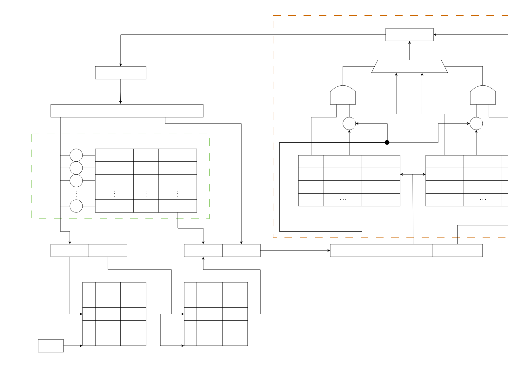

# Blind Test 题包（已剥离答案）

> 本文件由 `make_blind_test.py` 从核心真题自动生成，**所有参考答案与解析块已被移除**。
> 作答者只能看到题面与元数据，不得检索源仓库中的对应真题文件。
>
> **示意图**：题目引用的示意图已复制到本目录 `images/` 下（原始 SVG 及其渲染的 PNG）。
> 请用 `read_image` 工具读取 **PNG**（SVG 无法直接作为图像读取）。
> 若某题的图缺失或无法判读，请在 `uncertainty` 中明确说明"无法读取示意图"，
> **不要凭想象补图**——这会被记为 `UNVERIFIABLE` 而不是你的失误。

---

## 408-26-A-T41

> **年份** 2026年 ｜ **科目** 数据结构 ｜ **题型** 综合应用题 ｜ **分值** 13分 ｜ **考点** 二叉排序树

（本题满分 13 分）

假定二叉搜索树使用二叉链表存储，存储结构如下：

```c
typedef struct BSTNode{
    int data;
    struct BSTNode *left,*right;
} BSTNode;
typedef BSTNode BTNode;
```

给一棵二叉搜索树 T 和整数 K，查找树中关键字与 K 之差的绝对值最小的所有结点，并输出该绝对值与结点中的关键字。

（1）给出算法的基本思想。（4 分）

（2）使用 C/C++ 描述算法思想。（8 分）

> **【唯一编号】** `408-26-A-T41`
> **【题型】** 综合应用题
> **【科目】** 数据结构
> **【分值】** 13分
> **【年份】** 2026年
> **【考点】** 二叉排序树

---

---

## 408-19-A-T42

> **年份** 2019年 ｜ **科目** 数据结构 ｜ **题型** 综合应用题 ｜ **分值** 13分 ｜ **考点** 队列

请设计一个队列，要求满足：

① 初始时队列为空；

② 入队时，允许增加队列占用空间；

③ 出队后，出队元素所占用的空间可重复使用，即整个队列所占用的空间只增不减；

④ 入队操作和出队操作的时间复杂度始终保持为 O(1) 。

请回答下列问题：

(1) 该队列是应选择链式存储结构，还是应选择顺序存储结构？

(2) 画出队列的初始状态，并给出判断队空和队满的条件。

(3) 画出第一个元素入队后的队列状态。

(4) 给出入队操作和出队操作的基本过程。

> **【唯一编号】** `408-19-A-T42`
> **【题型】** 综合应用题
> **【科目】** 数据结构
> **【分值】** 13分
> **【年份】** 2019年
> **【考点】** 队列

---

---

## 408-26-A-T44

> **年份** 2026年 ｜ **科目** 计算机组成原理 ｜ **题型** 综合应用题 ｜ **分值** 13分 ｜ **考点** 数据通路、控制器

（本题满分 13 分）

假定 43 题中计算机 C 的部分数据通路如题 44 所示。


图中带箭头虚线代表控制信号，IR.rt、IR.rs 分别表示 IR 中的 rt、rs 字段，IR₁₁₋₀ 为 IR 的低 12 位，要求取指令周期完成 PC 增量操作，请回答下列问题

（1）①和②是同一类部件，其名称是什么（1 分）

（2）I 型指令中 imm8 可以是带符号或无符号整数，M 型指令中 offset 是带符号整数，则 EXTOP 至少有几位？为什么？（2 分）

（3）取指周期中 MARSrC、ALUA SrC、ALUB SrC、RegWr 的取值各是什么？（4 分）

（4）左移指令周期中 ALUB SrC、RegWsrc、RegDst、RegWr 的取值各是什么？Extop 是否可以与 M 型指令中的 EXTop 相同？为什么？（2 分）

> **【唯一编号】** `408-26-A-T44`
> **【题型】** 综合应用题
> **【科目】** 计算机组成原理
> **【分值】** 13分
> **【年份】** 2026年
> **【考点】** 数据通路、控制器

---

---

## 408-18-A-T44

> **年份** 2018年 ｜ **科目** 计算机组成原理 ｜ **题型** 综合应用题 ｜ **分值** 10分 ｜ **考点** 虚拟页式管理、TLB、cache映射方式

某计算机采用页式虚拟存储管理方式，按字节编址。CPU 进行存储访问的过程如题 44 图所示。



根据题 44 图回答下列问题。

(1) 主存物理地址占多少位？

(2) TLB 采用什么映射方式？TLB 用 SRAM 还是 DRAM 实现？

(3) Cache 采用什么映射方式？若 Cache 采用 LRU 替换算法和回写（Write Back）策略，则 Cache 每行中除数据（Data）、Tag 和有效位外，还应有哪些附加位？Cache 总容量是多少？Cache 中有效位的作用是什么？

(4) 若 CPU 给出的虚拟地址为 0008C040H，则对应的物理地址是多少？是否在 Cache 中命中？说明理由。若 CPU 给出的虚拟地址为 0007C260H，则该地址所在主存块映射到的 Cache 组号是多少？

> **【唯一编号】** `408-18-A-T44`
> **【题型】** 综合应用题
> **【科目】** 计算机组成原理
> **【分值】** 10分
> **【年份】** 2018年
> **【考点】** 虚拟页式管理、TLB、cache映射方式

---

---

## 408-24-A-T46

> **年份** 2024年 ｜ **科目** 操作系统 ｜ **题型** 综合应用题 ｜ **分值** 8分 (各小问: 2, 3, 3分) ｜ **考点** 进程概念、信号量

计算机系统中的进程之间往往需要相互协作以完成一个任务，在某网络系统中缓冲区 B 用于存放一个数据分组，对 B 的操作有 C1、C2 和 C3。C1 将一个数据分组写入 B 中，C2 从 B 中读出一个数据分组，C3 对 B 中的数据分组进行修改。要求 B 为空时才能执行 C1，B 非空时才能执行 C2 和 C3。请回答下列问题。

（1）假设进程 P1 和 P2 均需执行 C1，实现 C1 的代码是否为临界区？为什么？(2 分）

（2）假设 B 初始为空，进程 P1 执行 C1 一次，进程 P2 执行 C2 一次。请定义尽可能少的信号量。并用 wait()，signal() 操作描述进程 P1、P2 之间的同步或互斥关系，说明所用信号量的作用及初值。（3 分）

（3）假设 B 初始不为空，进程 P1 和 P2 各执行 C3 一次，请定义尽可能少的信号量。并用 wait()、signal() 操作描述进程 P1 和 P2 之间的同步或互斥关系，说明所用信号量的作用及初值。（3 分）

> **【唯一编号】** `408-24-A-T46`
> **【题型】** 综合应用题
> **【科目】** 操作系统
> **【分值】** 8分 (各小问: 2, 3, 3分)
> **【年份】** 2024年
> **【考点】** 进程概念、信号量

---

---

## 408-18-A-T45

> **年份** 2018年 ｜ **科目** 操作系统 ｜ **题型** 综合应用题 ｜ **分值** 7分 ｜ **考点** 地址翻译、clock算法

请根据题 44 图给出的虚拟存储管理方式，回答下列问题。

(1) 某虚拟地址对应的页目录号为 6，在相应的页表中对应的页号为 6，页内偏移量为 8，该虚拟地址的十六进制表示是什么？

(2) 寄存器 PDBR 用于保存当前进程的页目录起始地址，该地址是物理地址还是虚拟地址？进程切换时，PDBR 的内容是否会变化？说明理由。同一进程的线程切换时，PDBR 的内容是否会变化？说明理由。

(3) 为了支持改进型 CLOCK 置换算法，需要在页表项中设置哪些字段？

> **【唯一编号】** `408-18-A-T45`
> **【题型】** 综合应用题
> **【科目】** 操作系统
> **【分值】** 7分
> **【年份】** 2018年
> **【考点】** 地址翻译、clock算法

---

---

## 408-26-A-T47

> **年份** 2026年 ｜ **科目** 计算机网络 ｜ **题型** 综合应用题 ｜ **分值** 9分 ｜ **考点** TCP三次握手、TCP拥塞控制、TCP四次挥手

（本题满分 9 分）

假设客户端 C 建立一条 TCP 连接，向服务器 Si 上传一个总长度为 2000 B 的计算任务描述文件。已知 C 的拥塞窗口初始阈值为 8 MSS，MSS = 500 B，Si 对收到的每个 TCP 段进行确认，且确认段不封装数据。接收窗口始终为 1000 B，RTT = 5 ms，C 建立连接时选择的初始序号为 1000，Si 选择的初始序号为 2000，SYN、ACK、FIN 为标志位，seq 为序号，ack_seq 为确认序号。在整个文件传输过程中未出现任何重传或报文丢失。


（1）C 与 Si 建立 TCP 连接过程需要几次握手？C 收到的 SYN = 1，ACK = 1 的 TCP 段的确认序号是多少？

（2）当 C 接收 Si 发送的 ACK = 1，seq = 2001，ack_seq = 2001，rwnd = 1000 确认段后，C 的拥塞窗口增加到多少？C 的发送窗口设置为多少？

（3）C 与 Si 释放 TCP 连接过程需要几次挥手？C 收到最后一个 TCP 报文段的序号（seq），确认序号（ack_seq），FIN 的值分别是多少？

（4）忽略报文段传输时延，且时间从 C 请求建立 TCP 连接时刻算起，则 C 确定 Si 已成功接收到文件的时间是多少？

> **【唯一编号】** `408-26-A-T47`
> **【题型】** 综合应用题
> **【科目】** 计算机网络
> **【分值】** 9分
> **【年份】** 2026年
> **【考点】** TCP三次握手、TCP拥塞控制、TCP四次挥手

---

---

## 408-22-A-T47

> **年份** 2022年 ｜ **科目** 计算机网络 ｜ **题型** 综合应用题 ｜ **分值** 9分 ｜ **考点** 传输介质、CSMA/CD限制条件、DHCP

某网络拓扑如题 47 图所示，R 为路由器，S 为以太网交换机，AP 是 802.11 接入点，路由器的 E0 接口和 DHCP 服务器的 IP 地址配置如图中所示；H1 与 H2 属于同一个广播域，但不属于同一个冲突域；H2 和 H3 属于同一个冲突域；H4 和 H5 已经接入网络，并通过 DHCP 动态获取了 IP 地址。现有路由器、100BaseT 以太网交换机和 100BaseT 集线器 (Hub) 三类设备各若干台。


请回答下列问题。

- 设备 1 和设备 2 应该分别选择哪类设备？
- 若信号传播速度为 2x10⁸ m/s, 以太网最小帧长为 64 B, 信号通过设备 2 时会产生额外的 1.51 µs 的时间延迟，则 H2 与 H3 之间可以相距的最远距离是多少？
- 在 H4 通过 DHCP 动态获取 IP 地址过程中，H4 首先发送了 DHCP 报文 M, M 是哪种 DHCP 报文？路由器 E0 接口能否收到封装 M 的以太网帧？S 向 DHCP 服务器转发的封装 M 的以太网帧的目的 MAC 地址是什么？
- 若 H4 向 H5 发送一个 1P 分组 P, 则 H5 收到的封装 P 的 802.11 帧的地址 1、地址 2 和地址 3 分别是什么？

> **【唯一编号】** `408-22-A-T47`
> **【题型】** 综合应用题
> **【科目】** 计算机网络
> **【分值】** 9分
> **【年份】** 2022年
> **【考点】** 传输介质、CSMA/CD限制条件、DHCP

---
