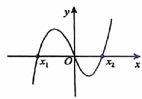
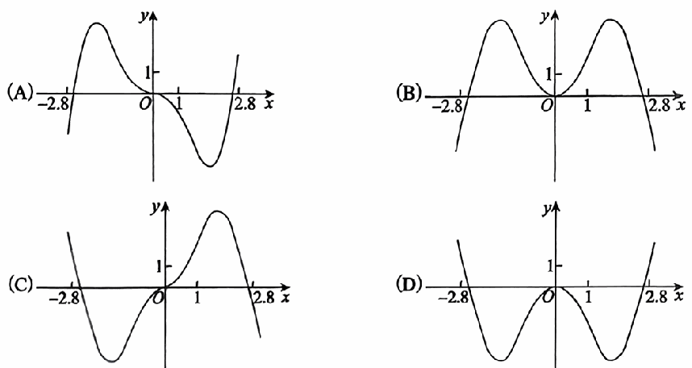

# 《张宇1000题》 · 基础篇 · 第0章 零基础

> 本章节收录第 1 页至第 16 页共 16 道题。

---

### 【ZY1000-JC-GS00-T01】第 1 题（P1）

1. “$\sin^2\alpha + \sin^2\beta = 1$”是“$\sin\alpha + \cos\beta = 0$”的（ ）.

- **A.** 充分非必要条件
- **B.** 必要非充分条件
- **C.** 充分必要条件
- **D.** 既非充分又非必要条件

> **【唯一编号】** `ZY1000-JC-GS00-T01`
> **【科目】** 基础篇
> **【专题】** 第0章 零基础

---

### 【ZY1000-JC-GS00-T02】第 2 题（P2）

2. 证明：对任意正整数 $n$，均有 $2^n+2>n^2$。

> **【唯一编号】** `ZY1000-JC-GS00-T02`
> **【科目】** 基础篇
> **【专题】** 第0章 零基础

---

### 【ZY1000-JC-GS00-T03】第 3 题（P3）

3. 设实数 $a\in(0,1)$，数列 $\{x_n\}$ 满足 $x_0=1$，且对任意正整数 $n$，均有 $x_n=\frac1{x_{n-1}}+a$。证明：对任意正整数 $n$，有 $x_n>1$。

> **【唯一编号】** `ZY1000-JC-GS00-T03`
> **【科目】** 基础篇
> **【专题】** 第0章 零基础

---

### 【ZY1000-JC-GS00-T04】第 4 题（P4）

4. $(2a^3+ab^2+b^3)(a^2b-ab^2)=\underline{\qquad}$.

> **【唯一编号】** `ZY1000-JC-GS00-T04`
> **【科目】** 基础篇
> **【专题】** 第0章 零基础

---

### 【ZY1000-JC-GS00-T05】第 5 题（P5）

5. 设 $\lambda\ne0,2$，则 $\frac{\lambda^4-3\lambda^3-6\lambda^2+16\lambda}{\lambda^2-2\lambda}=\underline{\qquad}$。

> **【唯一编号】** `ZY1000-JC-GS00-T05`
> **【科目】** 基础篇
> **【专题】** 第0章 零基础

---

### 【ZY1000-JC-GS00-T06】第 6 题（P6）

6. 设函数 $f(x)=\frac{x^2}{1+x^2}$，则 $f(1)+f(2)+f(3)+f(4)+f(\frac12)+f(\frac13)+f(\frac14)=\underline{\qquad}$。

> **【唯一编号】** `ZY1000-JC-GS00-T06`
> **【科目】** 基础篇
> **【专题】** 第0章 零基础

---

### 【ZY1000-JC-GS00-T07】第 7 题（P7）

7. 设 $f(x)$ 在 $[0,1]$ 上有定义，$f(0)=f(1)$，且对任意 $x_1,x_2\in[0,1]$，均有

$|f(x_1)-f(x_2)|\le|x_1-x_2|$。

证明：当 $a,b\in[0,1]$ 时，$|f(a)-f(b)|\le\frac12$。

> **【唯一编号】** `ZY1000-JC-GS00-T07`
> **【科目】** 基础篇
> **【专题】** 第0章 零基础

---

### 【ZY1000-JC-GS00-T08】第 8 题（P8）

8. 设 $x>0$，求函数 $y=x+\frac{4}{x^2}$ 的最小值。

> **【唯一编号】** `ZY1000-JC-GS00-T08`
> **【科目】** 基础篇
> **【专题】** 第0章 零基础

---

### 【ZY1000-JC-GS00-T09】第 9 题（P9）

9. 设实数 $x,y$ 满足 $3x^2+2y^2=6$，求 $2x+y$ 的最大值。

> **【唯一编号】** `ZY1000-JC-GS00-T09`
> **【科目】** 基础篇
> **【专题】** 第0章 零基础

---

### 【ZY1000-JC-GS00-T10】第 10 题（P10）

10. 函数 $f(x)=ax^3+bx^2-2x\;(a,b\in\mathbb R,\ ab\ne0)$ 的图像如图所示，且 $x_1+x_2<0$，则有（ ）。

- **A.** $a>0,b>0$
- **B.** $a<0,b<0$
- **C.** $a<0,b>0$
- **D.** $a>0,b<0$

> **【唯一编号】** `ZY1000-JC-GS00-T10`
> **【科目】** 基础篇
> **【专题】** 第0章 零基础

---

### 【ZY1000-JC-GS00-T11】第 11 题（P11）

11. 设函数 $f(x)$ 满足 $af(x)+f\left(\frac{1}{x}\right)=ax$，其中 $x\ne0$，$a^2\ne1$，求函数 $f(x)$ 的表达式。

> **【唯一编号】** `ZY1000-JC-GS00-T11`
> **【科目】** 基础篇
> **【专题】** 第0章 零基础

---

### 【ZY1000-JC-GS00-T12】第 12 题（P12）

12. 已知 $\cos(\frac\pi{12}-\theta)=\frac13$，则 $\sin(\frac{5\pi}{12}+\theta)$ 的值为 $\underline{\qquad}$。

> **【唯一编号】** `ZY1000-JC-GS00-T12`
> **【科目】** 基础篇
> **【专题】** 第0章 零基础

---

### 【ZY1000-JC-GS00-T13】第 13 题（P13）

13. 已知 $|x_1-3|<1,\ |x_2-3|<1$。求证：

（1）$4<x_1+x_2<8,\ |x_1-x_2|<2$；

（2）若 $f(x)=x^2-x+1$，且 $x_1\ne x_2$，则 $|x_1-x_2|<|f(x_1)-f(x_2)|<7|x_1-x_2|$。

> **【唯一编号】** `ZY1000-JC-GS00-T13`
> **【科目】** 基础篇
> **【专题】** 第0章 零基础

---

### 【ZY1000-JC-GS00-T14】第 14 题（P14）

14. 已知等差数列 $\{a_n\}$ 满足 $(a_1+a_2)+(a_2+a_3)+\cdots+(a_n+a_{n+1})=2n(n+1)\;(n\in\mathbb N_+)$。求：

（1）数列 $\{a_n\}$ 的通项公式；

（2）数列 $\{\frac{a_n}{2^{n-1}}\}$ 的前 $n$ 项和 $S_n$。

> **【唯一编号】** `ZY1000-JC-GS00-T14`
> **【科目】** 基础篇
> **【专题】** 第0章 零基础

---

### 【ZY1000-JC-GS00-T15】第 15 题（P15）

15. 函数 $y=-x^2+(e^x-e^{-x})\sin x$ 在区间 $[-2.8,2.8]$ 的图像大致为（ ）.

> **【唯一编号】** `ZY1000-JC-GS00-T15`
> **【科目】** 基础篇
> **【专题】** 第0章 零基础

---

### 【ZY1000-JC-GS00-T16】第 16 题（P16）

16. 已知曲线 $C$ 的极坐标方程是 $r=1$，以极点为原点、极轴为 $x$ 轴的正半轴建立平面直角坐标系，直线 $l$ 的参数方程为 $\begin{cases}x=1+\frac t2,\\y=2+\frac{\sqrt3}{2}t\end{cases}$（$t$ 为参数）。

（1）写出直线 $l$ 与曲线 $C$ 的直角坐标方程；

（2）设曲线 $C$ 经过伸缩变换 $\begin{cases}x'=3x,\\y'=y\end{cases}$ 得到曲线 $C'$，设曲线 $C'$ 上任一点为 $M(x,y)$，求 $\frac x3+\sqrt3\,y$ 的最小值。

> **【唯一编号】** `ZY1000-JC-GS00-T16`
> **【科目】** 基础篇
> **【专题】** 第0章 零基础

---

