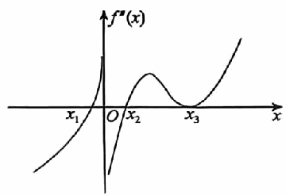

# 《张宇1000题》 · 基础篇 · 第5章 一元函数微分学的应用(一)——几何应用

> 本章节收录第 85 页至第 108 页共 24 道题。

---

### 【ZY1000-JC-GS05-T01】第 1 题（P85）

1. 函数 $y=e^x+\frac{e^{-x}}2$ 的最小值为 $\underline{\qquad}$.

> **【唯一编号】** `ZY1000-JC-GS05-T01`
> **【科目】** 基础篇
> **【专题】** 第5章 一元函数微分学的应用(一)——几何应用

---

### 【ZY1000-JC-GS05-T02】第 2 题（P86）

2. 若函数 $f(x)=e^{-ax}-e^x$ 的极值点小于零，则常数 $a$ 的取值范围为 $\underline{\qquad}$.

> **【唯一编号】** `ZY1000-JC-GS05-T02`
> **【科目】** 基础篇
> **【专题】** 第5章 一元函数微分学的应用(一)——几何应用

---

### 【ZY1000-JC-GS05-T03】第 3 题（P87）

3. 设函数 $f(x)=\begin{cases}\cos|x|-1,&x\le0,\\x\ln x,&x>0,\end{cases}$，则 $x=0$ 是 $f(x)$ 的（ ）.

- **A.** 可导点，极值点
- **B.** 不可导点，极值点
- **C.** 可导点，非极值点
- **D.** 不可导点，非极值点

> **【唯一编号】** `ZY1000-JC-GS05-T03`
> **【科目】** 基础篇
> **【专题】** 第5章 一元函数微分学的应用(一)——几何应用

---

### 【ZY1000-JC-GS05-T04】第 4 题（P88）

4. 已知 $x^2+ax-3\ge\frac{10}3$（$x>0$）恒成立，则 $a$ 的取值范围为 $\underline{\qquad}$.

> **【唯一编号】** `ZY1000-JC-GS05-T04`
> **【科目】** 基础篇
> **【专题】** 第5章 一元函数微分学的应用(一)——几何应用

---

### 【ZY1000-JC-GS05-T05】第 5 题（P89）

5. 已知函数y=f(x) 连续,其二阶导函数的图像如图所示,则曲线y=f(x)
的拐点个数为( ).
- **A.** 1
- **B.** 2
- **C.** 3
- **D.** 4

> **【唯一编号】** `ZY1000-JC-GS05-T05`
> **【科目】** 基础篇
> **【专题】** 第5章 一元函数微分学的应用(一)——几何应用

---

### 【ZY1000-JC-GS05-T06】第 6 题（P90）

6. 设函数 $f(x)>0$ 且二阶可导，曲线 $y=\sqrt{f(x)}$ 有拐点 $(1,\sqrt2)$，$f'(1)=2$，则 $f''(1)=\underline{\qquad}$.

> **【唯一编号】** `ZY1000-JC-GS05-T06`
> **【科目】** 基础篇
> **【专题】** 第5章 一元函数微分学的应用(一)——几何应用

---

### 【ZY1000-JC-GS05-T07】第 7 题（P91）

7. 曲线 $y(x)=\ln|e^{2x}-1|$ 的斜渐近线为（ ）.

- **A.** $y=2x+\frac1e$
- **B.** $y=2x$
- **C.** $y=-2x+\frac1e$
- **D.** $y=-2x$

> **【唯一编号】** `ZY1000-JC-GS05-T07`
> **【科目】** 基础篇
> **【专题】** 第5章 一元函数微分学的应用(一)——几何应用

---

### 【ZY1000-JC-GS05-T08】第 8 题（P92）

8. 曲线 $y=x\ln(e+\frac1x)$ 的斜渐近线为（ ）.

- **A.** $y=x+e$
- **B.** $y=x-e$
- **C.** $y=x+\frac1e$
- **D.** $y=x-\frac1e$

> **【唯一编号】** `ZY1000-JC-GS05-T08`
> **【科目】** 基础篇
> **【专题】** 第5章 一元函数微分学的应用(一)——几何应用

---

### 【ZY1000-JC-GS05-T09】第 9 题（P93）

9. 曲线 $x^2-xy+y^2=1$ 在点 $(1,1)$ 处的曲率为 $\underline{\qquad}$.

> **【唯一编号】** `ZY1000-JC-GS05-T09`
> **【科目】** 基础篇
> **【专题】** 第5章 一元函数微分学的应用(一)——几何应用

---

### 【ZY1000-JC-GS05-T10】第 10 题（P94）

10. 已知曲线 $y=f(x)$ 在其点 $(0,1)$ 处的曲率圆方程为 $(x-1)^2+y^2=2$，且当 $x\to0$ 时，二阶可导函数 $f(x)$ 与 $a+bx+cx^2$ 的差为 $o(x^2)$，则（ ）.

- **A.** $a=0,b=1,c=\frac32$
- **B.** $a=1,b=0,c=1$
- **C.** $a=1,b=1,c=-1$
- **D.** $a=1,b=0,c=-1$

> **【唯一编号】** `ZY1000-JC-GS05-T10`
> **【科目】** 基础篇
> **【专题】** 第5章 一元函数微分学的应用(一)——几何应用

---

### 【ZY1000-JC-GS05-T11】第 11 题（P95）

11. 设在 $(-\infty,+\infty)$ 内，$f''(x)<0$，$f(0)\ge0$，则函数 $\frac{f(x)}x$（ ）.

A. 在 $(-\infty,0)$ 内单调减少，在 $(0,+\infty)$ 内单调增加
B. 在 $(-\infty,0)$ 和 $(0,+\infty)$ 内单调减少
C. 在 $(-\infty,0)$ 内单调增加，在 $(0,+\infty)$ 内单调减少
D. 在 $(-\infty,0)$ 和 $(0,+\infty)$ 内单调增加

> **【唯一编号】** `ZY1000-JC-GS05-T11`
> **【科目】** 基础篇
> **【专题】** 第5章 一元函数微分学的应用(一)——几何应用

---

### 【ZY1000-JC-GS05-T12】第 12 题（P96）

12. 设 $f(x)$ 连续，且 $\lim_{x\to0}\frac{f(x)}{x^2}=k$（$k<0$），则 $f(x)$ 在点 $x=0$ 处（ ）.

A. 导数不存在
B. 导数存在，且 $f'(0)\ne0$
C. 取得极小值
D. 取得极大值

> **【唯一编号】** `ZY1000-JC-GS05-T12`
> **【科目】** 基础篇
> **【专题】** 第5章 一元函数微分学的应用(一)——几何应用

---

### 【ZY1000-JC-GS05-T13】第 13 题（P97）

13. 设 $M=\max\{1,\sqrt2,\sqrt[3]3,\cdots,\sqrt[n]n\}$（$n>4$），则 $M=$（ ）.

- **A.** $\sqrt2$
- **B.** $\sqrt[3]3$
- **C.** $\sqrt[4]4$
- **D.** $\sqrt[n]n$

> **【唯一编号】** `ZY1000-JC-GS05-T13`
> **【科目】** 基础篇
> **【专题】** 第5章 一元函数微分学的应用(一)——几何应用

---

### 【ZY1000-JC-GS05-T14】第 14 题（P98）

14. 设函数 $f(x)=n^2e^{x/n}-(1+n)x$，若 $f(x)$ 在 $x=\xi_n$ 处取得极值，则 $\lim_{n\to\infty}\xi_n=\underline{\qquad}$.

> **【唯一编号】** `ZY1000-JC-GS05-T14`
> **【科目】** 基础篇
> **【专题】** 第5章 一元函数微分学的应用(一)——几何应用

---

### 【ZY1000-JC-GS05-T15】第 15 题（P99）

15. 曲线 $y=x+\frac{|\ln x|}x$（ ）.

A. 有铅直渐近线，也有斜渐近线
B. 有水平渐近线，也有斜渐近线
C. 有且仅有铅直渐近线
D. 有且仅有水平渐近线

> **【唯一编号】** `ZY1000-JC-GS05-T15`
> **【科目】** 基础篇
> **【专题】** 第5章 一元函数微分学的应用(一)——几何应用

---

### 【ZY1000-JC-GS05-T16】第 16 题（P100）

16. 设函数f(x) 在[0, 1] 上可导，f(0) =0，f' (x ) 严格单调递增，则对任意x\in (0, 1) ，有( ).
A. f(x) >f' (0 ) x>f(1) x B. f' (0 ) x>f(x) >f(1) x
C. f(1) x>f' (0 ) x>f(x) D. f(1) x>f(x) >f' (0 )
x

> **【唯一编号】** `ZY1000-JC-GS05-T16`
> **【科目】** 基础篇
> **【专题】** 第5章 一元函数微分学的应用(一)——几何应用

---

### 【ZY1000-JC-GS05-T17】第 17 题（P101）

17. 已知函数 $y=f(x)$ 对一切 $x$ 满足 $\sqrt[3]x\,f''(x)+xf'(x)=e^{-x}-1$，若 $f'(x_0)=0$（$x_0\ne0$），则（ ）.

A. $x=x_0$ 是 $f(x)$ 的极小值点
B. $x=x_0$ 是 $f(x)$ 的极大值点
C. $(x_0,f(x_0))$ 是曲线 $y=f(x)$ 的拐点
D. 以上结论均不正确

> **【唯一编号】** `ZY1000-JC-GS05-T17`
> **【科目】** 基础篇
> **【专题】** 第5章 一元函数微分学的应用(一)——几何应用

---

### 【ZY1000-JC-GS05-T18】第 18 题（P102）

18. 已知函数 $f(x)=ax^3+x^2+2$ 在 $x=0$ 和 $x=-1$ 处取得极值，求 $f(x)$ 的增减区间、极大值、极小值和拐点。

> **【唯一编号】** `ZY1000-JC-GS05-T18`
> **【科目】** 基础篇
> **【专题】** 第5章 一元函数微分学的应用(一)——几何应用

---

### 【ZY1000-JC-GS05-T19】第 19 题（P103）

19. 设 $f(x)=nx(1-x)^n$（$n\in\mathbb N^+$），且记 $M(n)=\max_{x\in[0,1]}f(x)$，则必有（ ）.

A. $\lim_{n\to\infty}M(n)=e$
B. $\lim_{n\to\infty}M(n)=\frac1e$
C. $\lim_{n\to\infty}M(n)=0$
D. $\lim_{n\to\infty}M(n)=\infty$

> **【唯一编号】** `ZY1000-JC-GS05-T19`
> **【科目】** 基础篇
> **【专题】** 第5章 一元函数微分学的应用(一)——几何应用

---

### 【ZY1000-JC-GS05-T20】第 20 题（P104）

20. 曲线 $y=\frac{x^2+1}{x^2-1}$ 的渐近线的条数为（ ）.

- **A.** 4
- **B.** 3
- **C.** 2
- **D.** 1

> **【唯一编号】** `ZY1000-JC-GS05-T20`
> **【科目】** 基础篇
> **【专题】** 第5章 一元函数微分学的应用(一)——几何应用

---

### 【ZY1000-JC-GS05-T21】第 21 题（P105）

21. 曲线 $y=\frac{2+e^{-x^4}}{1-e^{-x^4}}$（ ）.

A. 仅有斜渐近线
B. 仅有水平渐近线
C. 仅有铅直渐近线
D. 既有水平渐近线，又有铅直渐近线

> **【唯一编号】** `ZY1000-JC-GS05-T21`
> **【科目】** 基础篇
> **【专题】** 第5章 一元函数微分学的应用(一)——几何应用

---

### 【ZY1000-JC-GS05-T22】第 22 题（P106）

22. 曲线 $y=(4+5x)e^{1/x}$ 的斜渐近线是 $\underline{\qquad}$.

> **【唯一编号】** `ZY1000-JC-GS05-T22`
> **【科目】** 基础篇
> **【专题】** 第5章 一元函数微分学的应用(一)——几何应用

---

### 【ZY1000-JC-GS05-T23】第 23 题（P107）

23. 曲线 $y=e^{1/x}\sqrt{x^2-4x+1}$ 的渐近线条数为（ ）.

- **A.** 1
- **B.** 2
- **C.** 3
- **D.** 4

> **【唯一编号】** `ZY1000-JC-GS05-T23`
> **【科目】** 基础篇
> **【专题】** 第5章 一元函数微分学的应用(一)——几何应用

---

### 【ZY1000-JC-GS05-T24】第 24 题（P108）

24. 曲线 $x^2=y+1$ 在点 $(0,-1)$ 的曲率圆方程为 $\underline{\qquad}$.

> **【唯一编号】** `ZY1000-JC-GS05-T24`
> **【科目】** 基础篇
> **【专题】** 第5章 一元函数微分学的应用(一)——几何应用

---

