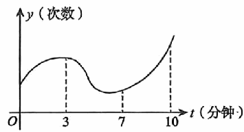

# 《张宇1000题》 · 基础篇 · 第7章 一元函数微分学的应用(三)——物理应用

> 本章节收录第 131 页至第 135 页共 5 道题。

---

### 【ZY1000-JC-GS07-T01】第 1 题（P131）

1. 一动点 $P$ 在曲线 $9y=4x^2$ 上运动，设坐标轴的单位长度是 $1\,\mathrm{cm}$。若点 $P$ 横坐标的变化率是 $30\,\mathrm{cm/s}$，则当点 $P$ 经过点 $(3,4)$ 时，点 $P$ 到原点距离的变化率为 $\underline{\qquad}$.

> **【唯一编号】** `ZY1000-JC-GS07-T01`
> **【科目】** 基础篇
> **【专题】** 第7章 一元函数微分学的应用(三)——物理应用

---

### 【ZY1000-JC-GS07-T02】第 2 题（P132）

2. 设二阶可导函数y=f(t)
表示某人在10分钟内心跳次数的变化曲线，如图所示.则关于此人心跳
次数的增长速度，说法正确的是( ).
A. 0∼3分钟增速变大;7∼10分钟增速变大 B. 0∼3分钟增速变大;7∼10分钟增速变小
C. 0∼3分钟增速变大;7∼10分钟增速变大 D. 0∼3分钟增速变小;7∼10分钟增速变小

> **【唯一编号】** `ZY1000-JC-GS07-T02`
> **【科目】** 基础篇
> **【专题】** 第7章 一元函数微分学的应用(三)——物理应用

---

### 【ZY1000-JC-GS07-T03】第 3 题（P133）

3. 已知一容器中水增加的速率为 $1\,\mathrm{m^3/min}$，且水的体积 $V$ 与水面高度 $y$ 满足 $V=\frac{\pi}{2}y^2$。当水面上升到高为 $1\,\mathrm m$ 时，求水面高度上升的速率。

> **【唯一编号】** `ZY1000-JC-GS07-T03`
> **【科目】** 基础篇
> **【专题】** 第7章 一元函数微分学的应用(三)——物理应用

---

### 【ZY1000-JC-GS07-T04】第 4 题（P134）

4. 已知某圆柱体底面半径与高随时间变化的速率分别为 $2\,\mathrm{cm/s}$，$-3\,\mathrm{cm/s}$，且圆柱体的体积与表面积随时间变化的速率分别为 $-100\pi\,\mathrm{cm^3/s}$，$40\pi\,\mathrm{cm^2/s}$，则圆柱体的底面半径与高分别为（ ）.

- **A.** $5\,\mathrm{cm},5\,\mathrm{cm}$
- **B.** $10\,\mathrm{cm},5\,\mathrm{cm}$
- **C.** $5\,\mathrm{cm},10\,\mathrm{cm}$
- **D.** $10\,\mathrm{cm},10\,\mathrm{cm}$

> **【唯一编号】** `ZY1000-JC-GS07-T04`
> **【科目】** 基础篇
> **【专题】** 第7章 一元函数微分学的应用(三)——物理应用

---

### 【ZY1000-JC-GS07-T05】第 5 题（P135）

5. 一物体在距离同一水平面上的地面观测器 $10\,\mathrm m$ 处离地匀速垂直上升，其速度为 $a\,\mathrm{m/s}$。若该物体上升到离地 $20\,\mathrm m$ 时，观测器视线倾角的变化率为 $\frac1{10}$，则 $a=$（ ）.

- **A.** 1
- **B.** 2
- **C.** 3
- **D.** 5

> **【唯一编号】** `ZY1000-JC-GS07-T05`
> **【科目】** 基础篇
> **【专题】** 第7章 一元函数微分学的应用(三)——物理应用

---

