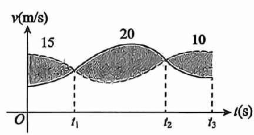

# 《张宇1000题》 · 基础篇 · 第8章 一元函数积分学的概念与性质

> 本章节收录第 136 页至第 160 页共 25 道题。

---

### 【ZY1000-JC-GS08-T01】第 1 题（P136）

1. 设函数 $f(x)$ 在区间 $[0,1]$ 上连续，则 $\int_0^1 f(x)\,dx=$（ ）.

A. $\lim_{n\to\infty}\sum_{k=1}^n f(\frac{3k-1}{3n})\frac1{3n}$
B. $\lim_{n\to\infty}\sum_{k=1}^n f(\frac{3k-1}{3n})\frac1n$
C. $\lim_{n\to\infty}\sum_{k=1}^{3n} f(\frac{k-1}{3n})\frac1n$
D. $\lim_{n\to\infty}\sum_{k=1}^{3n} f(\frac{k}{3n})\frac3n$

> **【唯一编号】** `ZY1000-JC-GS08-T01`
> **【科目】** 基础篇
> **【专题】** 第8章 一元函数积分学的概念与性质

---

### 【ZY1000-JC-GS08-T02】第 2 题（P137）

2. $\lim_{n\to\infty}\frac1{n^3}\left[\ln\frac1n+4\ln\frac2n+\cdots+(n-1)^2\ln\frac{n-1}{n}\right]=\underline{\qquad}$.

> **【唯一编号】** `ZY1000-JC-GS08-T02`
> **【科目】** 基础篇
> **【专题】** 第8章 一元函数积分学的概念与性质

---

### 【ZY1000-JC-GS08-T03】第 3 题（P138）

3. 甲、乙两人赛跑，图中实线和虚线分别为甲和乙的速度曲线（单位：$\mathrm{m/s}$），三块阴影部分面积依次为 $15,20,10$，且当 $t=0$ 时，甲在乙前面 $10\,\mathrm m$ 处，则在 $[0,t_3]$ 上，甲、乙相遇的次数为（ ）.

A. 1
B. 2
C. 4
D. 4

> **【唯一编号】** `ZY1000-JC-GS08-T03`
> **【科目】** 基础篇
> **【专题】** 第8章 一元函数积分学的概念与性质

---

### 【ZY1000-JC-GS08-T04】第 4 题（P139）

4. 设 $M=\int_{-1/2}^{1/2}(1+\frac{x}{1+x^2})\,dx$，$N=\int_0^1\frac{(1+x)\ln^2(1+x)}{x^2}\,dx$，$K=\int_0^1\frac{e^x}{1+x}\,dx$，则（ ）.

- **A.** $M>N>K$
- **B.** $N>K>M$
- **C.** $K>M>N$
- **D.** $K>N>M$

> **【唯一编号】** `ZY1000-JC-GS08-T04`
> **【科目】** 基础篇
> **【专题】** 第8章 一元函数积分学的概念与性质

---

### 【ZY1000-JC-GS08-T05】第 5 题（P140）

5. 设 $f(x)$ 是 $(0,+\infty)$ 内的正值连续函数，且 $f'(x)<0$，$g(x)=\int_1^x f(t)\,dt$，则 $g(\frac12)$ 和 $g(\frac32)$ 的可能取值是（ ）.

- **A.** $-2,1$
- **B.** $-2,3$
- **C.** $2,-1$
- **D.** $2,-3$

> **【唯一编号】** `ZY1000-JC-GS08-T05`
> **【科目】** 基础篇
> **【专题】** 第8章 一元函数积分学的概念与性质

---

### 【ZY1000-JC-GS08-T06】第 6 题（P141）

6. 设 $f(x)=\begin{cases}x\ln x,&x>0,\\x^2+x,&x\le0.\end{cases}$，若 $\int_a^b f(x)\,dx$（$a<b$）取得最小值，则 $(a,b)=$（ ）.

- **A.** $(-1,1)$
- **B.** $(-1,2)$
- **C.** $(0,1)$
- **D.** $(1,2)$

> **【唯一编号】** `ZY1000-JC-GS08-T06`
> **【科目】** 基础篇
> **【专题】** 第8章 一元函数积分学的概念与性质

---

### 【ZY1000-JC-GS08-T07】第 7 题（P142）

7. 设函数 $g(x)$ 在 $[0,\frac\pi2]$ 上连续，若在 $(0,\frac\pi2)$ 内 $g'(x)\ge0$，则对任意的 $x\in(0,\frac\pi2)$，有（ ）.

A. $\int_x^{\pi/2}g(t)\,dt\ge\int_x^{\pi/2}g(\sin t)\,dt$
B. $\int_x^1g(t)\,dt\le\int_x^1g(\sin t)\,dt$
C. $\int_x^1g(t)\,dt\ge\int_x^1g(\sin t)\,dt$
D. $\int_x^{\pi/2}g(t)\,dt\le\int_x^{\pi/2}g(\sin t)\,dt$

> **【唯一编号】** `ZY1000-JC-GS08-T07`
> **【科目】** 基础篇
> **【专题】** 第8章 一元函数积分学的概念与性质

---

### 【ZY1000-JC-GS08-T08】第 8 题（P143）

8. 若 $\sqrt{1-x^2}$ 是 $xf(x)$ 的一个原函数，则 $\int_0^1\frac1{f(x)}\,dx=$（ ）.

- **A.** $-1$
- **B.** $\frac\pi4$
- **C.** $-\frac\pi4$
- **D.** $1$

> **【唯一编号】** `ZY1000-JC-GS08-T08`
> **【科目】** 基础篇
> **【专题】** 第8章 一元函数积分学的概念与性质

---

### 【ZY1000-JC-GS08-T09】第 9 题（P144）

9. $\lim_{n\to\infty}\sum_{i=1}^n\frac1{\sqrt{in}}=\underline{\qquad}$.

> **【唯一编号】** `ZY1000-JC-GS08-T09`
> **【科目】** 基础篇
> **【专题】** 第8章 一元函数积分学的概念与性质

---

### 【ZY1000-JC-GS08-T10】第 10 题（P145）

10. 设 $f(x)$ 是 $(-\infty,+\infty)$ 上可导的奇函数，任意的 $x\in(-\infty,+\infty)$，均有 $f(x+1)-f(x)=f(1)$，$f(\frac12)=0$，则以下是偶函数的是（ ）.

A. $\int_0^x[\sin f(t)+f(t+1)]\,dt$
B. $\int_0^x[\sin f'(t)+f'(t+1)]\,dt$
C. $\int_0^x[\cos f(t)+f(t+2)]\,dt$
D. $\int_0^x[\cos f'(t)+f'(t+2)]\,dt$

> **【唯一编号】** `ZY1000-JC-GS08-T10`
> **【科目】** 基础篇
> **【专题】** 第8章 一元函数积分学的概念与性质

---

### 【ZY1000-JC-GS08-T11】第 11 题（P146）

11. 设 $f(x)$ 是实数集上连续的偶函数，在 $(-\infty,0)$ 上有唯一零点 $x_0=-1$，且 $f'(x_0)=1$，则函数 $F(x)=\int_0^x f(t)\,dt$ 的严格单调增区间是（ ）.

- **A.** $(-\infty,-1)$
- **B.** $(-1,+\infty)$
- **C.** $(-1,1)$
- **D.** $(1,+\infty)$

> **【唯一编号】** `ZY1000-JC-GS08-T11`
> **【科目】** 基础篇
> **【专题】** 第8章 一元函数积分学的概念与性质

---

### 【ZY1000-JC-GS08-T12】第 12 题（P147）

12. 设 $f(x)$ 在 $[0,2]$ 上单调连续，$f(0)=1$，$f(2)=2$，且对任意 $x_1,x_2\in[0,2]$ 总有 $f(\frac{x_1+x_2}2)>\frac{f(x_1)+f(x_2)}2$，$g(x)$ 是 $f(x)$ 的反函数，$P=\int_1^2 g(x)\,dx$，则（ ）.

- **A.** $3<P<4$
- **B.** $2<P<3$
- **C.** $1<P<2$
- **D.** $0<P<1$

> **【唯一编号】** `ZY1000-JC-GS08-T12`
> **【科目】** 基础篇
> **【专题】** 第8章 一元函数积分学的概念与性质

---

### 【ZY1000-JC-GS08-T13】第 13 题（P148）

13. 下列反常积分中，发散的是（ ）.

- **A.** $\int_0^{+\infty}xe^{-x}\,dx$
- **B.** $\int_{-\infty}^{+\infty}xe^{-x^2}\,dx$
- **C.** $\int_{-\infty}^{+\infty}\frac{\arctan x}{1+x^2}\,dx$
- **D.** $\int_{-\infty}^{+\infty}\frac{x}{1+x^2}\,dx$

> **【唯一编号】** `ZY1000-JC-GS08-T13`
> **【科目】** 基础篇
> **【专题】** 第8章 一元函数积分学的概念与性质

---

### 【ZY1000-JC-GS08-T14】第 14 题（P149）

14. 若反常积分 $\int_0^{+\infty}\frac{\ln x}{(1+x)x^{1-p}}\,dx$ 收敛，则（ ）.

- **A.** $p<1$
- **B.** $p>1$
- **C.** $0<p<1$
- **D.** $0\le p<1$

> **【唯一编号】** `ZY1000-JC-GS08-T14`
> **【科目】** 基础篇
> **【专题】** 第8章 一元函数积分学的概念与性质

---

### 【ZY1000-JC-GS08-T15】第 15 题（P150）

15. 下列反常积分收敛的是（ ）.

- **A.** $\int_2^{+\infty}\frac1{x\ln x}\,dx$
- **B.** $\int_0^{+\infty}e^{-x^2}\,dx$
- **C.** $\int_{-1}^1\frac1{\sin x}\,dx$
- **D.** $\int_0^1\frac{x}{\ln^2(1+x)}\,dx$

> **【唯一编号】** `ZY1000-JC-GS08-T15`
> **【科目】** 基础篇
> **【专题】** 第8章 一元函数积分学的概念与性质

---

### 【ZY1000-JC-GS08-T16】第 16 题（P151）

16. $\lim_{n\to\infty}\frac1{n^2}\left[\sqrt{n^2-1}+\sqrt{n^2-2^2}+\cdots+\sqrt{n^2-(n-1)^2}\right]=\underline{\qquad}$.

> **【唯一编号】** `ZY1000-JC-GS08-T16`
> **【科目】** 基础篇
> **【专题】** 第8章 一元函数积分学的概念与性质

---

### 【ZY1000-JC-GS08-T17】第 17 题（P152）

17. $\lim_{n\to\infty}\sum_{i=1}^n\frac{n}{n^2+9i^2}=\underline{\qquad}$.

> **【唯一编号】** `ZY1000-JC-GS08-T17`
> **【科目】** 基础篇
> **【专题】** 第8章 一元函数积分学的概念与性质

---

### 【ZY1000-JC-GS08-T18】第 18 题（P153）

18. 定积分 $I=\int_{\pi/4}^{\pi/2}\frac{\sin x}{x}\,dx$ 的值满足（ ）.

- **A.** $0\le I\le\frac12$
- **B.** $\frac12\le I\le\frac{\sqrt2}2$
- **C.** $\frac{\sqrt2}2\le I\le1$
- **D.** $1\le I\le2\sqrt2$

> **【唯一编号】** `ZY1000-JC-GS08-T18`
> **【科目】** 基础篇
> **【专题】** 第8章 一元函数积分学的概念与性质

---

### 【ZY1000-JC-GS08-T19】第 19 题（P154）

19. 设 $f(x)\not\equiv0$ 为 $(-\infty,+\infty)$ 上可导的奇函数，则下列函数为奇函数的是（ ）.

A. $x^3\int_0^x f'(t)\,dt$
B. $\int_0^x f(-t)\,dt$
C. $\int_0^x[f'(t)+f(t)]\,dt$
D. $\int_0^x|f(t)|\,dt$

> **【唯一编号】** `ZY1000-JC-GS08-T19`
> **【科目】** 基础篇
> **【专题】** 第8章 一元函数积分学的概念与性质

---

### 【ZY1000-JC-GS08-T20】第 20 题（P155）

20. 设 $M=\int_{-\pi/2}^{\pi/2}\frac{x}{1+x^2}\cos^5x\,dx$，$N=\int_{-\pi/2}^{\pi/2}(x^2\sin x+\sin^2x\cos x)\,dx$，$P=\int_{-\pi/2}^{\pi/2}(\sin^3x-\cos^4x)\,dx$，则有（ ）.

- **A.** $N<P<M$
- **B.** $M<P<N$
- **C.** $N<M<P$
- **D.** $P<M<N$

> **【唯一编号】** `ZY1000-JC-GS08-T20`
> **【科目】** 基础篇
> **【专题】** 第8章 一元函数积分学的概念与性质

---

### 【ZY1000-JC-GS08-T21】第 21 题（P156）

21. 设 $a,b$ 为常数，$\int_0^1\frac{\ln x}{x^a(\tan\frac{\pi x}2)^b}\,dx$ 收敛，则（ ）.

A. $a+b>1$ 且 $b>-2$
B. $a+b<1$ 且 $b>-2$
C. $a+b>1$ 且 $b<-2$
D. $a+b<1$ 且 $b<-2$

> **【唯一编号】** `ZY1000-JC-GS08-T21`
> **【科目】** 基础篇
> **【专题】** 第8章 一元函数积分学的概念与性质

---

### 【ZY1000-JC-GS08-T22】第 22 题（P157）

22. 设 $F(x)=\int_0^x(t-[t])\,dt$，其中 $[x]$ 表示不超过 $x$ 的最大整数，则 $F'_-(1)-F'_+(1)=\underline{\qquad}$.

> **【唯一编号】** `ZY1000-JC-GS08-T22`
> **【科目】** 基础篇
> **【专题】** 第8章 一元函数积分学的概念与性质

---

### 【ZY1000-JC-GS08-T23】第 23 题（P158）

23. 下列命题中不成立的是（ ）.

A. 若 $f(x)$ 连续，$x\in[a,b]$，则 $\int_a^x f(t)\,dt$ 必为 $f(x)$ 的原函数
B. 若 $f(x)$ 可积，$x\in[a,b]$，则 $f(x)$ 在 $(a,b)$ 内存在原函数
C. 若 $f(x)$ 连续，且为奇函数，$x\in[-a,a]$，则 $\int_{-a}^a f(x)\,dx=0$
D. 若 $f(x)$ 连续，$T$ 为其周期，则 $\int_a^{a+T}f(x)\,dx=\int_0^T f(x)\,dx$

> **【唯一编号】** `ZY1000-JC-GS08-T23`
> **【科目】** 基础篇
> **【专题】** 第8章 一元函数积分学的概念与性质

---

### 【ZY1000-JC-GS08-T24】第 24 题（P159）

24. 设 $f(x-5)=\frac4{x^2-10x}$，则 $\int_0^4 f(2x+1)\,dx$（ ）.

A. 为反常积分，且发散
B. 为反常积分，且收敛
C. 不是反常积分，且其值为 $10$
D. 不是反常积分，且其值为 $\frac\pi4$

> **【唯一编号】** `ZY1000-JC-GS08-T24`
> **【科目】** 基础篇
> **【专题】** 第8章 一元函数积分学的概念与性质

---

### 【ZY1000-JC-GS08-T25】第 25 题（P160）

25. 下列表达式中正确的是（ ）.

A. $\int_\pi^{2\pi}|\sin x|\,dx\le\int_\pi^{2\pi}\sin^2x\,dx$
B. $\int_{-\pi/4}^{\pi/4}\frac{x}{1+\cos x}\,dx<\int_{-\pi/4}^{\pi/4}(\frac{\sin x}{1+x^4}+\frac1{1+x^2})\,dx$
C. $\int_a^b f(x)\,dx\le\int_c^d f(x)\,dx$，$[a,b]\subset[c,d]$，$f(x)$ 连续，$x\in[c,d]$
D. $\int_{-1}^1|f(x)|\,dx=2\int_0^1|f(x)|\,dx$，$f(x)$ 连续，$x\in[-1,1]$

> **【唯一编号】** `ZY1000-JC-GS08-T25`
> **【科目】** 基础篇
> **【专题】** 第8章 一元函数积分学的概念与性质

---

