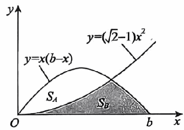
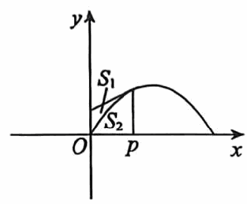

# 《张宇1000题》 · 基础篇 · 第10章 一元函数积分学的应用(一)——几何应用

> 本章节收录第 198 页至第 216 页共 19 道题。

---

### 【ZY1000-JC-GS10-T01】第 1 题（P198）

1. 曲线 $y=\frac{1}{x^2+4x+5}$ 在区间 $(0,+\infty)$ 上与 $x$ 轴所围成的图形的面积为 $\underline{\qquad}$.

> **【唯一编号】** `ZY1000-JC-GS10-T01`
> **【科目】** 基础篇
> **【专题】** 第10章 一元函数积分学的应用(一)——几何应用

---

### 【ZY1000-JC-GS10-T02】第 2 题（P199）

2. 曲线 $y=\frac{\ln x}{x}$ 在 $[1,e^2]$ 上与 $x$ 轴所围成的图形的面积是 $\underline{\qquad}$.

> **【唯一编号】** `ZY1000-JC-GS10-T02`
> **【科目】** 基础篇
> **【专题】** 第10章 一元函数积分学的应用(一)——几何应用

---

### 【ZY1000-JC-GS10-T03】第 3 题（P200）

3. 如图所示，抛物线 $y=(\sqrt2-1)x^2$ 把曲线 $y=x(b-x)$（$b>0$）与 $x$ 轴所围成的闭区域分成面积为 $S_A$ 与 $S_B$ 的两部分，则（ ）.

A. $S_A<S_B$
B. $S_A=S_B$
C. $S_A>S_B$
D. $S_A$ 与 $S_B$ 的大小关系与 $b$ 的数值有关

> **【唯一编号】** `ZY1000-JC-GS10-T03`
> **【科目】** 基础篇
> **【专题】** 第10章 一元函数积分学的应用(一)——几何应用

---

### 【ZY1000-JC-GS10-T04】第 4 题（P201）

4. 过点 $(p,\sin p)$ 作曲线 $y=\sin x$ 的切线（见图），设该曲线与切线及 $y$ 轴所围成的图形的面积为 $S_1$，曲线与直线 $x=p$ 及 $x$ 轴所围成的图形的面积为 $S_2$，则（ ）.

A. $\lim_{p\to0^+}\frac{S_2}{S_1+S_2}=\frac13$
B. $\lim_{p\to0^+}\frac{S_2}{S_1+S_2}=\frac12$
C. $\lim_{p\to0^+}\frac{S_2}{S_1+S_2}=\frac23$
D. $\lim_{p\to0^+}\frac{S_2}{S_1+S_2}=1$

> **【唯一编号】** `ZY1000-JC-GS10-T04`
> **【科目】** 基础篇
> **【专题】** 第10章 一元函数积分学的应用(一)——几何应用

---

### 【ZY1000-JC-GS10-T05】第 5 题（P202）

5. 平面无界区域 $D=\{(x,y)\mid(1+x^2)|y|\le1\}$ 的面积为 $\underline{\qquad}$.

> **【唯一编号】** `ZY1000-JC-GS10-T05`
> **【科目】** 基础篇
> **【专题】** 第10章 一元函数积分学的应用(一)——几何应用

---

### 【ZY1000-JC-GS10-T06】第 6 题（P203）

6. 设平面区域 $D$ 由曲线段 $y=\sin\pi x$（$0\le x\le1$）与 $x$ 轴围成，则 $D$ 绕 $y$ 轴旋转一周所成旋转体的体积为 $\underline{\qquad}$.

> **【唯一编号】** `ZY1000-JC-GS10-T06`
> **【科目】** 基础篇
> **【专题】** 第10章 一元函数积分学的应用(一)——几何应用

---

### 【ZY1000-JC-GS10-T07】第 7 题（P204）

7. 已知函数 $f(x)=x\int_1^x\frac{e^{t^2}}t\,dt$，则 $f(x)$ 在 $(0,1)$ 上的平均值为 $\underline{\qquad}$.

> **【唯一编号】** `ZY1000-JC-GS10-T07`
> **【科目】** 基础篇
> **【专题】** 第10章 一元函数积分学的应用(一)——几何应用

---

### 【ZY1000-JC-GS10-T08】第 8 题（P205）

8. 已知曲线 $L:y=e^{-x}$（$x\ge0$），设 $P$ 是 $L$ 上的动点，$V$ 是 $L$ 上从点 $A(0,1)$ 到点 $P$ 的一段弧绕 $x$ 轴旋转一周所得的旋转体体积。当 $P$ 运动到点 $(1,1/e)$ 时，沿 $x$ 轴正向的速度为 $1$，求此时 $V$ 关于时间 $t$ 的变化率。

> **【唯一编号】** `ZY1000-JC-GS10-T08`
> **【科目】** 基础篇
> **【专题】** 第10章 一元函数积分学的应用(一)——几何应用

---

### 【ZY1000-JC-GS10-T09】第 9 题（P206）

9. 曲线 $y=\ln\sin x$（$\frac{\pi}{6}\le x\le\frac{\pi}{3}$）的弧长为 $\underline{\qquad}$.

> **【唯一编号】** `ZY1000-JC-GS10-T09`
> **【科目】** 基础篇
> **【专题】** 第10章 一元函数积分学的应用(一)——几何应用

---

### 【ZY1000-JC-GS10-T10】第 10 题（P207）

10. 曲线 $r=e^\theta$ 从 $\theta=0$ 到 $\theta=1$ 的弧长为 $\underline{\qquad}$.

> **【唯一编号】** `ZY1000-JC-GS10-T10`
> **【科目】** 基础篇
> **【专题】** 第10章 一元函数积分学的应用(一)——几何应用

---

### 【ZY1000-JC-GS10-T11】第 11 题（P208）

11. 已知函数 $y=y(x)$ 由方程 $y^4-6xy+3=0$（$1\le y\le2$）所确定，则曲线 $y=y(x)$ 从点 $(\frac{2}{3},1)$ 到点 $(\frac{19}{12},2)$ 的长度为 $\underline{\qquad}$.

> **【唯一编号】** `ZY1000-JC-GS10-T11`
> **【科目】** 基础篇
> **【专题】** 第10章 一元函数积分学的应用(一)——几何应用

---

### 【ZY1000-JC-GS10-T12】第 12 题（P209）

12. 曲线 $y=e^x$ 与其过原点的切线及 $y$ 轴所围图形的面积为（ ）.

A. $\int_0^1(\ln y-y\ln y)\,dx$
B. $\int_0^1(e^x-e^x)\,dx$
C. $\int_1^e(\ln y-y\ln y)\,dx$
D. $\int_1^e(e^x-xe^x)\,dx$

> **【唯一编号】** `ZY1000-JC-GS10-T12`
> **【科目】** 基础篇
> **【专题】** 第10章 一元函数积分学的应用(一)——几何应用

---

### 【ZY1000-JC-GS10-T13】第 13 题（P210）

13. 曲线 $y=x^2e^{-x}$（$0\le x<+\infty$）绕 $x$ 轴旋转一周所得延展到无穷远的旋转体的体积为 $\underline{\qquad}$.

> **【唯一编号】** `ZY1000-JC-GS10-T13`
> **【科目】** 基础篇
> **【专题】** 第10章 一元函数积分学的应用(一)——几何应用

---

### 【ZY1000-JC-GS10-T14】第 14 题（P211）

14. 曲线 $f(x)=x\ln x$（$0<x\le2$）绕 $x$ 轴旋转一周所得旋转体的体积为 $\underline{\qquad}$.

> **【唯一编号】** `ZY1000-JC-GS10-T14`
> **【科目】** 基础篇
> **【专题】** 第10章 一元函数积分学的应用(一)——几何应用

---

### 【ZY1000-JC-GS10-T15】第 15 题（P212）

15. 曲线 $y=\frac12x^2$（$0\le x\le1$）的长度为 $\underline{\qquad}$.

> **【唯一编号】** `ZY1000-JC-GS10-T15`
> **【科目】** 基础篇
> **【专题】** 第10章 一元函数积分学的应用(一)——几何应用

---

### 【ZY1000-JC-GS10-T16】第 16 题（P213）

16. 设平面 $D$ 是由 $y=\ln x$，$x=1$，$y=1$ 围成的第一象限的有界区域，记 $D$ 绕 $x$ 轴与绕 $y=1$ 旋转一周所得旋转体的体积分别为 $V_1,V_2$，则（ ）.

- **A.** $V_1>\frac\pi2>V_2$
- **B.** $V_2>\frac\pi2>V_1$
- **C.** $\frac\pi2>V_1>V_2$
- **D.** $\frac\pi2>V_2>V_1$

> **【唯一编号】** `ZY1000-JC-GS10-T16`
> **【科目】** 基础篇
> **【专题】** 第10章 一元函数积分学的应用(一)——几何应用

---

### 【ZY1000-JC-GS10-T17】第 17 题（P214）

17. 曲线 $y=x^2$ 从点 $(1,1)$ 到点 $(2,4)$ 的一段弧绕 $y$ 轴旋转一周所得旋转体的侧面积为 $\underline{\qquad}$.

> **【唯一编号】** `ZY1000-JC-GS10-T17`
> **【科目】** 基础篇
> **【专题】** 第10章 一元函数积分学的应用(一)——几何应用

---

### 【ZY1000-JC-GS10-T18】第 18 题（P215）

18. 函数 $y=\frac{x^2}{\sqrt{1-x^2}}$ 在区间 $[0,1]$ 上的平均值为 $\underline{\qquad}$.

> **【唯一编号】** `ZY1000-JC-GS10-T18`
> **【科目】** 基础篇
> **【专题】** 第10章 一元函数积分学的应用(一)——几何应用

---

### 【ZY1000-JC-GS10-T19】第 19 题（P216）

19. 设平面区域 $D=\left\{(x,y)\mid0\le y\le\frac{\sqrt{x^2-1}}{x^2},\ \sqrt2\le x\le2\right\}$，求：（1）$D$ 的面积；（2）$D$ 绕 $x$ 轴旋转一周所成旋转体的体积。

> **【唯一编号】** `ZY1000-JC-GS10-T19`
> **【科目】** 基础篇
> **【专题】** 第10章 一元函数积分学的应用(一)——几何应用

---

