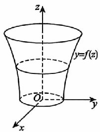

# 《张宇1000题》 · 基础篇 · 第15章 微分方程

> 本章节收录第 283 页至第 303 页共 21 道题。

---

### 【ZY1000-JC-GS15-T01】第 1 题（P283）

1. xdy+ydx=sinxdx满足y(\pi)
=0的特解为_____.

> **【唯一编号】** `ZY1000-JC-GS15-T01`
> **【科目】** 基础篇
> **【专题】** 第15章 微分方程

---

### 【ZY1000-JC-GS15-T02】第 2 题（P284）

2. 已知曲线上任一点的切线在y轴上的截距与法线在x轴上的截距之比为3:1,则该曲线方程为__
___.

> **【唯一编号】** `ZY1000-JC-GS15-T02`
> **【科目】** 基础篇
> **【专题】** 第15章 微分方程

---

### 【ZY1000-JC-GS15-T03】第 3 题（P285）

3. 设 $y_1,y_2$ 是一阶非齐次线性微分方程 $y'+p(x)y=q(x)$ 的两个特解，若常数 $\lambda,\mu$ 使 $\lambda y_1+\mu y_2$ 是该方程的解，$\lambda y_1-\mu y_2$ 是该方程对应的齐次方程的解，则（ ）.

- **A.** $\lambda=\frac12,\mu=\frac12$
- **B.** $\lambda=-\frac12,\mu=-\frac12$
- **C.** $\lambda=\frac23,\mu=\frac13$
- **D.** $\lambda=\frac23,\mu=\frac23$

> **【唯一编号】** `ZY1000-JC-GS15-T03`
> **【科目】** 基础篇
> **【专题】** 第15章 微分方程

---

### 【ZY1000-JC-GS15-T04】第 4 题（P286）

4. 求微分方程 $(2x-3xy^2-y^3)y'+y^3=0$ 的通解。

> **【唯一编号】** `ZY1000-JC-GS15-T04`
> **【科目】** 基础篇
> **【专题】** 第15章 微分方程

---

### 【ZY1000-JC-GS15-T05】第 5 题（P287）

5. 过原点的曲线 $y=y(x)$ 满足 $\frac{dy}{dx}=(x+y)^2$，则 $\lim_{x\to0^+}[y(x)]^x=\underline{\qquad}$.

> **【唯一编号】** `ZY1000-JC-GS15-T05`
> **【科目】** 基础篇
> **【专题】** 第15章 微分方程

---

### 【ZY1000-JC-GS15-T06】第 6 题（P288）

6. 微分方程y'=(x+1 )
secy-tany的通解为_____.

> **【唯一编号】** `ZY1000-JC-GS15-T06`
> **【科目】** 基础篇
> **【专题】** 第15章 微分方程

---

### 【ZY1000-JC-GS15-T07】第 7 题（P289）

7. 设函数 $y(x)$ 是微分方程 $y'+\frac1{x^2}y=2e^{1/x}$ 满足 $y(\frac12)=0$ 的解。（1）求 $y=y(x)$ 的表达式；（2）求曲线 $y(x)$ 的斜渐近线。

> **【唯一编号】** `ZY1000-JC-GS15-T07`
> **【科目】** 基础篇
> **【专题】** 第15章 微分方程

---

### 【ZY1000-JC-GS15-T08】第 8 题（P290）

8. 以 $yOz$ 面上的平面曲线段 $y=f(z)$（$z\ge0$）绕 $z$ 轴旋转一周所成旋转曲面与 $xOy$ 面围成一个无上盖容器（见图），现以 $3\,\mathrm{cm^3/s}$ 的速率把水注入容器内，水面的面积以 $\pi\,\mathrm{cm^2/s}$ 的速率增大。已知容器底面积为 $16\pi\,\mathrm{cm^2}$，求曲线 $y=f(z)$ 的方程。

> **【唯一编号】** `ZY1000-JC-GS15-T08`
> **【科目】** 基础篇
> **【专题】** 第15章 微分方程

---

### 【ZY1000-JC-GS15-T09】第 9 题（P291）

9. 设 $f(x)$ 有连续导数，$x\in[0,+\infty)$，且满足方程 $\int_0^x(x-1)f(t)\,dt-\int_0^x ff(t)\,dt=x$，求函数 $f(x)$。

> **【唯一编号】** `ZY1000-JC-GS15-T09`
> **【科目】** 基础篇
> **【专题】** 第15章 微分方程

---

### 【ZY1000-JC-GS15-T10】第 10 题（P292）

10. 设 $\varphi(x)$ 为连续函数，$|\varphi(x)|\le k$（$k$ 为常数），求微分方程 $\frac{dy}{dx}+y=\varphi(x)$ 满足初始条件 $y(0)=0$ 的特解 $y(x)$，并证明当 $x\ge0$ 时，有 $|y(x)|\le k(1-e^{-x})$。

> **【唯一编号】** `ZY1000-JC-GS15-T10`
> **【科目】** 基础篇
> **【专题】** 第15章 微分方程

---

### 【ZY1000-JC-GS15-T11】第 11 题（P293）

11. 设函数 $y=y(x)$ 是微分方程 $2xy'-4y=2\ln x-1$ 满足条件 $y(1)=\frac14$ 的解，求曲线 $y=y(x)$ 在 $[1,e]$ 上的平均值。

> **【唯一编号】** `ZY1000-JC-GS15-T11`
> **【科目】** 基础篇
> **【专题】** 第15章 微分方程

---

### 【ZY1000-JC-GS15-T12】第 12 题（P294）

12. 设曲线y=y(x) )x>0 ) 经过点(1, 0) ,该曲线上任一点P(x, y) 到y轴的距离等于该点处的切线在
y轴上的截距,求y(x) 在区间(0, 1)
上与x轴所围平面图形的面积.

> **【唯一编号】** `ZY1000-JC-GS15-T12`
> **【科目】** 基础篇
> **【专题】** 第15章 微分方程

---

### 【ZY1000-JC-GS15-T13】第 13 题（P295）

13. 设曲线 $y=y(x)$ 上点 $P(0,4)$ 处的切线垂直于直线 $x-2y+5=0$，且该曲线满足微分方程 $y''+2y'+y=0$，则此曲线方程为（ ）.

A. $y=\frac92xe^{-x}$
B. $y=(4+\frac92x)e^{-x}$
C. $y=(C_1x+C_2)e^{-x}$
D. $y=2(x+2)e^{-x}$

> **【唯一编号】** `ZY1000-JC-GS15-T13`
> **【科目】** 基础篇
> **【专题】** 第15章 微分方程

---

### 【ZY1000-JC-GS15-T14】第 14 题（P296）

14. 设曲线 $y=y(x)$ 经过原点，且在原点处的切线与直线 $2x+y+6=0$ 平行，而 $y(x)$ 满足微分方程 $y''-2y'+5y=0$，则此曲线的方程为（ ）.

A. $y=e^x\sin2x$
B. $y=-e^x\sin2x$
C. $y=e^x(\cos2x-\sin2x)$
D. $y=e^x(\sin2x-\cos2x)$

> **【唯一编号】** `ZY1000-JC-GS15-T14`
> **【科目】** 基础篇
> **【专题】** 第15章 微分方程

---

### 【ZY1000-JC-GS15-T15】第 15 题（P297）

15. 设 $y=y(x)$ 满足 $y''-2y'+y=0$，且 $y(0)=0$，$y'(0)=1$，则 $\int_{-\infty}^0y(x)\,dx=\underline{\qquad}$.

> **【唯一编号】** `ZY1000-JC-GS15-T15`
> **【科目】** 基础篇
> **【专题】** 第15章 微分方程

---

### 【ZY1000-JC-GS15-T16】第 16 题（P298）

16. 已知某常系数齐次线性微分方程的通解为 $y=C_1+e^x(C_2\cos2x+C_3\sin2x)$，则该微分方程为 $\underline{\qquad}$.

> **【唯一编号】** `ZY1000-JC-GS15-T16`
> **【科目】** 基础篇
> **【专题】** 第15章 微分方程

---

### 【ZY1000-JC-GS15-T17】第 17 题（P299）

17. 微分方程 $4y''-12y'+9y=e^{3x/2}(3x^2+2)$ 的特解形式为（ ）.

A. $Ax^2+Bx+C+De^{3x/2}$
B. $(Ax^2+Bx+C)e^{3x/2}$
C. $x(Ax^2+Bx+C)e^{3x/2}$
D. $x^2(Ax^2+Bx+C)e^{3x/2}$

> **【唯一编号】** `ZY1000-JC-GS15-T17`
> **【科目】** 基础篇
> **【专题】** 第15章 微分方程

---

### 【ZY1000-JC-GS15-T18】第 18 题（P300）

18. 已知 $y_1=xe^x+e^{2x}$，$y_2=xe^x+e^{-x}$，$y_3=xe^x+e^{2x}-e^{-x}$ 是某二阶常系数非齐次线性微分方程的三个解，则此微分方程为 $\underline{\qquad}$.

> **【唯一编号】** `ZY1000-JC-GS15-T18`
> **【科目】** 基础篇
> **【专题】** 第15章 微分方程

---

### 【ZY1000-JC-GS15-T19】第 19 题（P301）

19. 求微分方程 $y''-2y'+y=2(3x^2-2)e^x$ 的通解。

> **【唯一编号】** `ZY1000-JC-GS15-T19`
> **【科目】** 基础篇
> **【专题】** 第15章 微分方程

---

### 【ZY1000-JC-GS15-T20】第 20 题（P302）

20. 求微分方程y''+4y'+5y=8cosx,当x\to -\infty时为有界的特解.

> **【唯一编号】** `ZY1000-JC-GS15-T20`
> **【科目】** 基础篇
> **【专题】** 第15章 微分方程

---

### 【ZY1000-JC-GS15-T21】第 21 题（P303）

21. 欧拉方程 $x^2y''+3xy'+3y=0$ 满足条件 $y(1)=0$，$y'(1)=\sqrt2$ 的解为 $y=\underline{\qquad}$.

> **【唯一编号】** `ZY1000-JC-GS15-T21`
> **【科目】** 基础篇
> **【专题】** 第15章 微分方程

---

