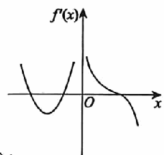
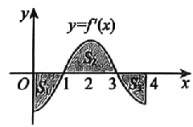

# 《张宇1000题》 · 强化篇 · 第5章 一元函数微分学的应用(一)——几何应用

> 本章节收录第 440 页至第 472 页共 33 道题。

---

### 【ZY1000-QH-GS05-T01】第 1 题（P440）

1. 设 $f(x)=|\ln|x||$，则( ).

- **A.** $x=1$ 不是 $f(x)$ 的极值点
- **B.** $(1,0)$ 不是 $y=f(x)$ 的拐点
- **C.** $x=-1$ 不是 $f(x)$ 的驻点
- **D.** $x=0$ 不是 $y=f(x)$ 的渐近线

> **【唯一编号】** `ZY1000-QH-GS05-T01`
> **【科目】** 强化篇
> **【专题】** 第5章 一元函数微分学的应用(一)——几何应用

---

### 【ZY1000-QH-GS05-T02】第 2 题（P441）

2. 设 $f(x)$ 在 $x=0$ 处连续，且 $\lim_{x\to0}\frac{[f(x)+1]x^2}{x-\sin x}=2$，则曲线 $y=f(x)$ 在点 $(0,f(0))$ 处的切线方程为_____.

> **【唯一编号】** `ZY1000-QH-GS05-T02`
> **【科目】** 强化篇
> **【专题】** 第5章 一元函数微分学的应用(一)——几何应用

---

### 【ZY1000-QH-GS05-T03】第 3 题（P442）

3. 设 $f(x)$ 在 $[a,b]$ 上可导，且在点 $x=a$ 处取最小值，在点 $x=b$ 处取最大值，则( ).

- **A.** $f'_+(a)\le0,f'_-(b)\le0$
- **B.** $f'_+(a)\le0,f'_-(b)\ge0$
- **C.** $f'_+(a)\ge0,f'_-(b)\le0$
- **D.** $f'_+(a)\ge0,f'_-(b)\ge0$

> **【唯一编号】** `ZY1000-QH-GS05-T03`
> **【科目】** 强化篇
> **【专题】** 第5章 一元函数微分学的应用(一)——几何应用

---

### 【ZY1000-QH-GS05-T04】第 4 题（P443）

4. 设函数 $f(x)=(x^2+a)e^x$，若 $f(x)$ 既没有极值点也没有拐点，则 $a$ 的取值范围是( ).

- **A.** $[0,1)$
- **B.** $[1,+\infty)$
- **C.** $[1,2)$
- **D.** $[2,+\infty)$

> **【唯一编号】** `ZY1000-QH-GS05-T04`
> **【科目】** 强化篇
> **【专题】** 第5章 一元函数微分学的应用(一)——几何应用

---

### 【ZY1000-QH-GS05-T05】第 5 题（P444）

5. 使得 $\ln x\le a\sqrt{x}$ 恒成立的最小正数 $a$ 为_____.

> **【唯一编号】** `ZY1000-QH-GS05-T05`
> **【科目】** 强化篇
> **【专题】** 第5章 一元函数微分学的应用(一)——几何应用

---

### 【ZY1000-QH-GS05-T06】第 6 题（P445）

6. 设 $e^{ax}\ge1+x$ 对任意实数 $x$ 均成立，则 $a$ 的取值范围为_____.

> **【唯一编号】** `ZY1000-QH-GS05-T06`
> **【科目】** 强化篇
> **【专题】** 第5章 一元函数微分学的应用(一)——几何应用

---

### 【ZY1000-QH-GS05-T07】第 7 题（P446）

7. 设函数 $f(x)=\int_0^1t|t-x|\,dt$（$0<x<1$），则 $f(x)$ 的单调区间及曲线 $y=f(x)$ 的凹凸区间分别为( ).

- **A.** 单调增区间 $(\frac{\sqrt2}{2},1)$；单调减区间 $(0,\frac{\sqrt2}{2})$；在 $(0,1)$ 内曲线为凹
- **B.** 单调减区间 $(\frac{\sqrt2}{2},1)$；单调增区间 $(0,\frac{\sqrt2}{2})$；在 $(0,1)$ 内曲线为凹
- **C.** 单调增区间 $(\frac{\sqrt2}{2},1)$；单调减区间 $(0,\frac{\sqrt2}{2})$；在 $(0,1)$ 内曲线为凸
- **D.** 单调减区间 $(\frac{\sqrt2}{2},1)$；单调增区间 $(0,\frac{\sqrt2}{2})$；在 $(0,1)$ 内曲线为凸

> **【唯一编号】** `ZY1000-QH-GS05-T07`
> **【科目】** 强化篇
> **【专题】** 第5章 一元函数微分学的应用(一)——几何应用

---

### 【ZY1000-QH-GS05-T08】第 8 题（P447）

8. 求函数 $f(x)=\int_1^x(x^2-t^2)\ln(1+t^2)\,dt$ 的极值。

> **【唯一编号】** `ZY1000-QH-GS05-T08`
> **【科目】** 强化篇
> **【专题】** 第5章 一元函数微分学的应用(一)——几何应用

---

### 【ZY1000-QH-GS05-T09】第 9 题（P448）

9. 设函数 $f(x)$ 在 $x=0$ 的某邻域内有定义，则以下结论正确的是( ).

- **A.** 若 $f(0)=0,f'(0)=0$，则 $x=0$ 必不是极值点
- **B.** 若 $f'(0)=0,f''(0)=0$，则 $x=0$ 必是极值点
- **C.** 若 $f(0)=0,f'(0)>0$，则存在 $\delta>0$，使得 $f(x)$ 在 $(0,\delta)$ 内单调递增
- **D.** 若 $f'(0)=0,f''(0)>0$，则存在 $\delta>0$，使得 $f(x)$ 在 $(-\delta,0)$ 内单调递减

> **【唯一编号】** `ZY1000-QH-GS05-T09`
> **【科目】** 强化篇
> **【专题】** 第5章 一元函数微分学的应用(一)——几何应用

---

### 【ZY1000-QH-GS05-T10】第 10 题（P449）

10. 曲线 $x^3-y^3=3x^2$ 的斜渐近线方程为( ).

- **A.** $x+y-1=0$
- **B.** $x+y+1=0$
- **C.** $x-y+1=0$
- **D.** $x-y-1=0$

> **【唯一编号】** `ZY1000-QH-GS05-T10`
> **【科目】** 强化篇
> **【专题】** 第5章 一元函数微分学的应用(一)——几何应用

---

### 【ZY1000-QH-GS05-T11】第 11 题（P450）

11. 设 $f'(x)$ 在 $[0,1]$ 上单调增加，$f(0)=f'(0)=0$，则在 $[0,1]$ 上( ).

- **A.** $e^xf(x)$ 单调增加，$e^{-x}f(x)$ 单调减少
- **B.** $e^xf(x)$ 单调增加，$e^{-x}f(x)$ 单调增加
- **C.** $e^xf(x)$ 单调减少，$e^{-x}f(x)$ 单调增加
- **D.** $e^xf(x)$ 单调减少，$e^{-x}f(x)$ 单调减少

> **【唯一编号】** `ZY1000-QH-GS05-T11`
> **【科目】** 强化篇
> **【专题】** 第5章 一元函数微分学的应用(一)——几何应用

---

### 【ZY1000-QH-GS05-T12】第 12 题（P451）

12. 已知函数 $y=f(x)$ 对一切 $x$ 满足 $xf''(x)+3x[f'(x)]^2=1-e^{-x}$。若 $f'(x_0)=0$（$x_0\neq0$），则( ).

- **A.** $f(x_0)$ 是函数 $f(x)$ 的极大值
- **B.** $f(x_0)$ 是函数 $f(x)$ 的极小值
- **C.** $(x_0,f(x_0))$ 是曲线 $y=f(x)$ 的拐点
- **D.** $f(x_0)$ 不是函数 $f(x)$ 的极值，$(x_0,f(x_0))$ 也不是曲线 $y=f(x)$ 的拐点

> **【唯一编号】** `ZY1000-QH-GS05-T12`
> **【科目】** 强化篇
> **【专题】** 第5章 一元函数微分学的应用(一)——几何应用

---

### 【ZY1000-QH-GS05-T13】第 13 题（P452）

13. 由 $\int_0^y e^{-t^2/4}\,dt=\frac13(\sqrt{x}-2)^2$ 所确定的函数 $y=y(x)$ ( ).

- **A.** 只有极大值点 $x=4$，极大值为0
- **B.** 只有极小值点 $x=4$，极小值为0
- **C.** 只有极大值点 $x=0$
- **D.** 有极大值点和极小值点分别为 $x=0,x=4$

> **【唯一编号】** `ZY1000-QH-GS05-T13`
> **【科目】** 强化篇
> **【专题】** 第5章 一元函数微分学的应用(一)——几何应用

---

### 【ZY1000-QH-GS05-T14】第 14 题（P453）

14. 设函数 $f(x),g(x)$ 在 $[a,b]$ 上连续，在 $(a,b)$ 内可导，$g'(x)>0$，则在 $(a,b)$ 上，“$\frac{f'(x)}{g'(x)}$ 严格单调递增”是“$\frac{f(x)-f(a)}{g(x)-g(a)}$ 严格单调递增”的( )

- **A.** 充分非必要条件
- **B.** 必要非充分条件
- **C.** 充分必要条件
- **D.** 既非充分又非必要条件

> **【唯一编号】** `ZY1000-QH-GS05-T14`
> **【科目】** 强化篇
> **【专题】** 第5章 一元函数微分学的应用(一)——几何应用

---

### 【ZY1000-QH-GS05-T15】第 15 题（P454）

15. 曲线 $y=(5x-3)e^{-1/x}$ 有渐近线( ).

- **A.** $x=0,y=5x+2$
- **B.** $x=0,y=5x-8$
- **C.** $x=0,y=5x-3$
- **D.** $x=0,y=5x-2$

> **【唯一编号】** `ZY1000-QH-GS05-T15`
> **【科目】** 强化篇
> **【专题】** 第5章 一元函数微分学的应用(一)——几何应用

---

### 【ZY1000-QH-GS05-T16】第 16 题（P455）

16. 曲线 $y=\frac{\sqrt{x^2-x+1}}{e^x-1}$ 的渐近线共有( ).

- **A.** 1条
- **B.** 2条
- **C.** 3条
- **D.** 4条或4条以上

> **【唯一编号】** `ZY1000-QH-GS05-T16`
> **【科目】** 强化篇
> **【专题】** 第5章 一元函数微分学的应用(一)——几何应用

---

### 【ZY1000-QH-GS05-T17】第 17 题（P456）

17. 曲线 $r(3\theta-\pi)=1$ 的斜渐近线为( ).

- **A.** $y=\sqrt2x-\frac32$
- **B.** $y=\sqrt2x+\frac32$
- **C.** $y=\sqrt3x-\frac23$
- **D.** $y=\sqrt3x+\frac23$

> **【唯一编号】** `ZY1000-QH-GS05-T17`
> **【科目】** 强化篇
> **【专题】** 第5章 一元函数微分学的应用(一)——几何应用

---

### 【ZY1000-QH-GS05-T18】第 18 题（P457）

18. 曲线 $y=x^2\ln\left(\sin\frac1x+\cos\frac1x\right)$ 的斜渐近线为_____.

> **【唯一编号】** `ZY1000-QH-GS05-T18`
> **【科目】** 强化篇
> **【专题】** 第5章 一元函数微分学的应用(一)——几何应用

---

### 【ZY1000-QH-GS05-T19】第 19 题（P458）

19. 求曲线 $y=x^2\left[\frac{(1+1/x)^x}{e}-1\right]$（$x>0$）的斜渐近线。

> **【唯一编号】** `ZY1000-QH-GS05-T19`
> **【科目】** 强化篇
> **【专题】** 第5章 一元函数微分学的应用(一)——几何应用

---

### 【ZY1000-QH-GS05-T20】第 20 题（P459）

20. 设函数 $f(x)$ 在 $x=2$ 的某邻域内连续，且有 $\lim_{x\to0}\frac{\ln[f(x+2)+e^{x^2}]}{1-\cos x}=4$，则 $x=2$ 是 $f(x)$ 的( ).

- **A.** 不可导点
- **B.** 驻点且是极大值点
- **C.** 驻点且是极小值点
- **D.** 可导点但不是驻点

> **【唯一编号】** `ZY1000-QH-GS05-T20`
> **【科目】** 强化篇
> **【专题】** 第5章 一元函数微分学的应用(一)——几何应用

---

### 【ZY1000-QH-GS05-T21】第 21 题（P460）

21. 设函数 $f(x)$ 在 $(-\infty,+\infty)$ 内连续，其一阶导函数 $f'(x)$ 的图形如图所示，并设在 $f'(x)$ 存在处 $f''(x)$ 也存在，则曲线 $y=f(x)$ 的拐点个数为( ).

- **A.** 1
- **B.** 2
- **C.** 3
- **D.** 4

> **【唯一编号】** `ZY1000-QH-GS05-T21`
> **【科目】** 强化篇
> **【专题】** 第5章 一元函数微分学的应用(一)——几何应用

---

### 【ZY1000-QH-GS05-T22】第 22 题（P461）

22. $f(x)=\frac1{1+|x|}+\frac1{1+|x-a|}$（$a>0$）的最大值为( ).

- **A.** $\frac{1+a}{2+a}$
- **B.** $\frac{2+a}{1+a}$
- **C.** $\frac{1+2a}{2+a}$
- **D.** $\frac{2+a}{1+2a}$

> **【唯一编号】** `ZY1000-QH-GS05-T22`
> **【科目】** 强化篇
> **【专题】** 第5章 一元函数微分学的应用(一)——几何应用

---

### 【ZY1000-QH-GS05-T23】第 23 题（P462）

23. 设 $f'(x)$ 在区间 $[0,4]$ 上连续，曲线 $y=f'(x)$ 与直线 $x=0,x=4,y=0$ 围成如图所示的三个区域，其面积分别为 $S_1=3,S_2=4,S_3=2$，且 $f(0)=1$，则 $f(x)$ 在 $[0,4]$ 上的最大值与最小值分别为( ).

- **A.** 2,-3
- **B.** 4,-3
- **C.** 2,-2
- **D.** 4,-2

> **【唯一编号】** `ZY1000-QH-GS05-T23`
> **【科目】** 强化篇
> **【专题】** 第5章 一元函数微分学的应用(一)——几何应用

---

### 【ZY1000-QH-GS05-T24】第 24 题（P463）

24. 设 $y=\tan^n x$ 在 $x=\frac\pi4$ 处的切线在 $x$ 轴上的截距为 $x_n$，则 $\lim_{n\to\infty}y(x_n)=$ ____.

> **【唯一编号】** `ZY1000-QH-GS05-T24`
> **【科目】** 强化篇
> **【专题】** 第5章 一元函数微分学的应用(一)——几何应用

---

### 【ZY1000-QH-GS05-T25】第 25 题（P464）

25. 过曲线 $\frac{x^2}4+y^2=1$（$x>0,y>0$）任意点作该曲线的切线，切线夹在两坐标轴之间的部分为 $L$，求 $L$ 的最小长度，以及 $L$ 的长度达到最小时的切点坐标。

> **【唯一编号】** `ZY1000-QH-GS05-T25`
> **【科目】** 强化篇
> **【专题】** 第5章 一元函数微分学的应用(一)——几何应用

---

### 【ZY1000-QH-GS05-T26】第 26 题（P465）

26. 求 $f(x)=\int_0^1\ln|x-t|\,dt$（$0\le x\le1$）的最大值。

> **【唯一编号】** `ZY1000-QH-GS05-T26`
> **【科目】** 强化篇
> **【专题】** 第5章 一元函数微分学的应用(一)——几何应用

---

### 【ZY1000-QH-GS05-T27】第 27 题（P466）

27. 设 $y=y(x)$ 满足微分方程 $(xy'-2)\ln x+y=0$，$y(e)=2$。

(1) 求 $y=y(x)$ 的表达式及其定义域；

(2) 求函数 $y=y(x)$ 的极值。

> **【唯一编号】** `ZY1000-QH-GS05-T27`
> **【科目】** 强化篇
> **【专题】** 第5章 一元函数微分学的应用(一)——几何应用

---

### 【ZY1000-QH-GS05-T28】第 28 题（P467）

28. 设 $y=y(x)$ 满足 $(xy-1)dx+x^2dy=0$，$x>0$，$y(1)=0$，求：

(1) $y=y(x)$ 的表达式；

(2) 曲线 $y=y(x)$ 的拐点及渐近线。

> **【唯一编号】** `ZY1000-QH-GS05-T28`
> **【科目】** 强化篇
> **【专题】** 第5章 一元函数微分学的应用(一)——几何应用

---

### 【ZY1000-QH-GS05-T29】第 29 题（P468）

29. 曲线 $y=x\ln\left(2+\frac1{x-1}\right)$ 的斜渐近线方程为( ).

- **A.** $y=x\ln2+1$
- **B.** $y=x\ln2+\frac12$
- **C.** $y=x\ln2-1$
- **D.** $y=x\ln2-\frac12$

> **【唯一编号】** `ZY1000-QH-GS05-T29`
> **【科目】** 强化篇
> **【专题】** 第5章 一元函数微分学的应用(一)——几何应用

---

### 【ZY1000-QH-GS05-T30】第 30 题（P469）

30. 求曲线 $y=x^3(e^{1/x}+e^{1/x}-2)$ 的全部渐近线。

> **【唯一编号】** `ZY1000-QH-GS05-T30`
> **【科目】** 强化篇
> **【专题】** 第5章 一元函数微分学的应用(一)——几何应用

---

### 【ZY1000-QH-GS05-T31】第 31 题（P470）

31. 设函数 $y=y(x)$ 由参数方程 $\begin{cases}x=2e^t+t+1,\\y=4(t-1)e^t+t^2\end{cases}$ 确定，则曲线 $y=y(x)$ 在 $t=0$ 对应点处的曲率为_____.

> **【唯一编号】** `ZY1000-QH-GS05-T31`
> **【科目】** 强化篇
> **【专题】** 第5章 一元函数微分学的应用(一)——几何应用

---

### 【ZY1000-QH-GS05-T32】第 32 题（P471）

32. 设 $y=f(x)$ 是由方程 $x(1+y)-e^y+1=0$ 确定的隐函数，则曲线 $y=f(x)$ 在点 $(0,0)$ 处的曲率为_____.

> **【唯一编号】** `ZY1000-QH-GS05-T32`
> **【科目】** 强化篇
> **【专题】** 第5章 一元函数微分学的应用(一)——几何应用

---

### 【ZY1000-QH-GS05-T33】第 33 题（P472）

33. 设圆与曲线 $x=y^2$ 在 $(0,0)$ 处有公切线且它们关于 $y$ 的二阶导数值相同，则该圆的方程为___.

> **【唯一编号】** `ZY1000-QH-GS05-T33`
> **【科目】** 强化篇
> **【专题】** 第5章 一元函数微分学的应用(一)——几何应用

---

