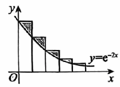
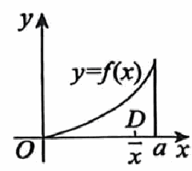

# 《张宇1000题》 · 强化篇 · 第10章 一元函数积分学的应用(一)——几何应用

> 本章节收录第 544 页至第 569 页共 26 道题。

---

### 【ZY1000-QH-GS10-T01】第 1 题（P544）

1. 曲线 $e^y+xy+x^3=e$ 在点 $(0,1)$ 处的切线与两坐标轴所围成的三角形的面积为_____.

> **【唯一编号】** `ZY1000-QH-GS10-T01`
> **【科目】** 强化篇
> **【专题】** 第10章 一元函数积分学的应用(一)——几何应用

---

### 【ZY1000-QH-GS10-T02】第 2 题（P545）

2. 曲线 $r=2\cos3\theta\ (0\le\theta\le\frac\pi6)$ 与 $\theta=0$ 及 $\theta=\frac\pi6$ 所围图形面积为_____.

> **【唯一编号】** `ZY1000-QH-GS10-T02`
> **【科目】** 强化篇
> **【专题】** 第10章 一元函数积分学的应用(一)——几何应用

---

### 【ZY1000-QH-GS10-T03】第 3 题（P546）

3. 若曲线 $r=a(1+\cos\theta)\ (a>0)$ 所围图形的面积为 $6\pi$，则 $a=$_____.

> **【唯一编号】** `ZY1000-QH-GS10-T03`
> **【科目】** 强化篇
> **【专题】** 第10章 一元函数积分学的应用(一)——几何应用

---

### 【ZY1000-QH-GS10-T04】第 4 题（P547）

4. 设函数 $y=y(x)$ 满足方程 $y''+3y'+2y=e^{-x}$，且 $\displaystyle\lim_{x\to0}\frac{y(x)}x=1$，求曲线 $y=y(x)$ 与 $x$ 轴正半轴之间的平面图形的面积及该平面图形绕 $y$ 轴旋转一周所形成的旋转体体积。

> **【唯一编号】** `ZY1000-QH-GS10-T04`
> **【科目】** 强化篇
> **【专题】** 第10章 一元函数积分学的应用(一)——几何应用

---

### 【ZY1000-QH-GS10-T05】第 5 题（P548）

5. 曲线 $y=\sqrt{x}$ 与 $y=x^2$ 所围平面有界区域绕直线 $y=x$ 旋转一周所得旋转体的体积为_____.

> **【唯一编号】** `ZY1000-QH-GS10-T05`
> **【科目】** 强化篇
> **【专题】** 第10章 一元函数积分学的应用(一)——几何应用

---

### 【ZY1000-QH-GS10-T06】第 6 题（P549）

6. 过坐标原点作曲线 $y=e^x$ 的切线，该切线与曲线 $y=e^x$ 以及 $x$ 轴围成的向 $x$ 轴负向无限伸展的图形记为 $D$。

(1) 求 $D$ 的面积；

(2) 求 $D$ 绕直线 $x=1$ 旋转一周所成的旋转体体积。

> **【唯一编号】** `ZY1000-QH-GS10-T06`
> **【科目】** 强化篇
> **【专题】** 第10章 一元函数积分学的应用(一)——几何应用

---

### 【ZY1000-QH-GS10-T07】第 7 题（P550）

7. 求曲线 $y=e^{-x/2}\sqrt{\sin x}\ (x\ge0)$ 绕 $x$ 轴旋转一周所成旋转体的体积。

> **【唯一编号】** `ZY1000-QH-GS10-T07`
> **【科目】** 强化篇
> **【专题】** 第10章 一元函数积分学的应用(一)——几何应用

---

### 【ZY1000-QH-GS10-T08】第 8 题（P551）

8. 设曲线 $y=ax^2\ (x\ge0,\text{常数 }a>0)$ 与曲线 $y=1-x^2$ 交于点 $A$，过坐标原点 $O$ 和点 $A$ 的直线与曲线 $y=ax^2$ 围成一平面图形 $D$。

(1) 求 $D$ 绕 $x$ 轴旋转一周所成的旋转体体积 $V(a)$；

(2) 求使 $V(a)$ 为最大值时 $a$ 的值。

> **【唯一编号】** `ZY1000-QH-GS10-T08`
> **【科目】** 强化篇
> **【专题】** 第10章 一元函数积分学的应用(一)——几何应用

---

### 【ZY1000-QH-GS10-T09】第 9 题（P552）

9. 设函数 $f(x)$ 在 $[0,1]$ 上连续，在 $(0,1)$ 内可导，且满足 $xf'(x)=f(x)+x^2$。已知曲线 $y=f(x)$ 与 $x=0$、$x=1$、$y=0$ 所围的图形 $S$ 面积为 $2$。求 $f(x)$ 的表达式，以及图形 $S$ 绕 $x$ 轴旋转一周所得旋转体的体积。

> **【唯一编号】** `ZY1000-QH-GS10-T09`
> **【科目】** 强化篇
> **【专题】** 第10章 一元函数积分学的应用(一)——几何应用

---

### 【ZY1000-QH-GS10-T10】第 10 题（P553）

10. 当 $x\ge0$ 时，在曲线 $y=e^{-2x}$ 上面作一个台阶曲线，台阶的宽度皆为 $1$（见图）。则图中无穷多个阴影部分的面积之和 $S=$_____.

> **【唯一编号】** `ZY1000-QH-GS10-T10`
> **【科目】** 强化篇
> **【专题】** 第10章 一元函数积分学的应用(一)——几何应用

---

### 【ZY1000-QH-GS10-T11】第 11 题（P554）

11. 设函数 $y=f(x)$ 满足微分方程 $\displaystyle y'+y=\frac{e^{-x}\cos x}{2\sqrt{\sin x}}$，且 $f(\pi)=0$，求曲线 $y=f(x)\ (x\ge0)$ 绕 $x$ 轴旋转一周所得旋转体的体积。

> **【唯一编号】** `ZY1000-QH-GS10-T11`
> **【科目】** 强化篇
> **【专题】** 第10章 一元函数积分学的应用(一)——几何应用

---

### 【ZY1000-QH-GS10-T12】第 12 题（P555）

12. 设 $f(x)$ 在 $(-\infty,+\infty)$ 内非负连续，且 $\displaystyle\int_0^x tf(x^2)f(x^2-t^2)\,dt=\sin^2x^2$，求 $f(x)$ 在 $[0,\pi]$ 上的平均值。

> **【唯一编号】** `ZY1000-QH-GS10-T12`
> **【科目】** 强化篇
> **【专题】** 第10章 一元函数积分学的应用(一)——几何应用

---

### 【ZY1000-QH-GS10-T13】第 13 题（P556）

13. 已知 $\displaystyle\frac{1}{1+e^{1/x}}$ 是函数 $f(x)$ 的一个原函数，则 $f(x)$ 在 $[-1,1]$ 上的平均值为_____.

> **【唯一编号】** `ZY1000-QH-GS10-T13`
> **【科目】** 强化篇
> **【专题】** 第10章 一元函数积分学的应用(一)——几何应用

---

### 【ZY1000-QH-GS10-T14】第 14 题（P557）

14. 已知函数 $f(x)$ 在 $[0,1]$ 上连续，在 $(0,1)$ 内是函数 $\displaystyle\frac{\sin\pi x}{x}$ 的一个原函数，且 $f(1)=0$，则 $f(x)$ 在区间 $[0,1]$ 上的平均值为_____.

> **【唯一编号】** `ZY1000-QH-GS10-T14`
> **【科目】** 强化篇
> **【专题】** 第10章 一元函数积分学的应用(一)——几何应用

---

### 【ZY1000-QH-GS10-T15】第 15 题（P558）

15. 设函数 $f(x)$ 非负连续，且 $\displaystyle f(x)\int_0^1 f(xt)\,dt=2x^2$，则 $f(x)$ 在区间 $[0,2]$ 上的平均值为_____.

> **【唯一编号】** `ZY1000-QH-GS10-T15`
> **【科目】** 强化篇
> **【专题】** 第10章 一元函数积分学的应用(一)——几何应用

---

### 【ZY1000-QH-GS10-T16】第 16 题（P559）

16. 设 $f(x)$ 为 $[0,3]$ 上的非负连续函数，且满足 $\displaystyle f(x)\int_1^2 f(xt-x)\,dt=2x^2$，$x\in[0,3]$，则 $f(x)$ 在区间 $[1,3]$ 上的平均值为_____.

> **【唯一编号】** `ZY1000-QH-GS10-T16`
> **【科目】** 强化篇
> **【专题】** 第10章 一元函数积分学的应用(一)——几何应用

---

### 【ZY1000-QH-GS10-T17】第 17 题（P560）

17. 已知函数 $f(x)$ 在 $[0,\frac{3\pi}{2}]$ 上连续，在 $(0,\frac{3\pi}{2})$ 内是函数 $\displaystyle\frac{\cos x}{2x-3\pi}$ 的一个原函数，且 $f(0)=0$，则 $f(x)$ 在区间 $[0,\frac{3\pi}{2}]$ 上的平均值为_____.

> **【唯一编号】** `ZY1000-QH-GS10-T17`
> **【科目】** 强化篇
> **【专题】** 第10章 一元函数积分学的应用(一)——几何应用

---

### 【ZY1000-QH-GS10-T18】第 18 题（P561）

18. 设 $\displaystyle f(x)=\int_{-1}^x t|t|\,dt$，求曲线 $y=f(x)$ 与 $x$ 轴所围成的封闭图形的面积。

> **【唯一编号】** `ZY1000-QH-GS10-T18`
> **【科目】** 强化篇
> **【专题】** 第10章 一元函数积分学的应用(一)——几何应用

---

### 【ZY1000-QH-GS10-T19】第 19 题（P562）

19. 已知函数 $f(x)$、$g(x)$ 分别满足 $f'(x)=2\sqrt{f(x)}$，$\displaystyle g'(x)=\frac{g(x)}{x-2}+\frac{x-2}{x}$，$f(0)=1$，$g(1)=0$。求曲线 $f(x)+g(y)=0$ 所围图形绕直线 $x=-1$ 旋转一周所成旋转体体积。

> **【唯一编号】** `ZY1000-QH-GS10-T19`
> **【科目】** 强化篇
> **【专题】** 第10章 一元函数积分学的应用(一)——几何应用

---

### 【ZY1000-QH-GS10-T20】第 20 题（P563）

20. 在曲线 $\sqrt{x}+\sqrt{y}=1$ 上的横坐标为 $a\ (0<a<1)$ 处作曲线的切线，将切线与 $x$ 轴、$y$ 轴所围成的图形绕 $y$ 轴旋转一周，使得旋转体的体积最大，求 $a$ 的值。

> **【唯一编号】** `ZY1000-QH-GS10-T20`
> **【科目】** 强化篇
> **【专题】** 第10章 一元函数积分学的应用(一)——几何应用

---

### 【ZY1000-QH-GS10-T21】第 21 题（P564）

21. 设函数 $x=x(y)$ 满足 $\displaystyle y=\int\frac{4y^3}{4-y^6}\,dx$，$L$ 为曲线 $x=x(y)\ (-2\le y\le-1)$，且 $x(-1)=-\frac9{16}$，记 $L$ 的长度为 $s$。求：

(1) $s$；

(2) $x$ 的最大值。

> **【唯一编号】** `ZY1000-QH-GS10-T21`
> **【科目】** 强化篇
> **【专题】** 第10章 一元函数积分学的应用(一)——几何应用

---

### 【ZY1000-QH-GS10-T22】第 22 题（P565）

22. 设连续函数 $y=y(x)$ 满足 $\displaystyle y'+\frac{t^2}{y}x^3=\frac yx$，$y(1)=\sqrt{9-t^2}$，其中 $0\le t\le3$，$x>0$。

(1) 利用换元 $z=y^2$ 求 $y=y(x)$ 的表达式；

(2) 令 $\displaystyle f(x)=\frac19\int_0^3 y(x)\,dt$，求曲线 $y=f(x)$ 的全长。

> **【唯一编号】** `ZY1000-QH-GS10-T22`
> **【科目】** 强化篇
> **【专题】** 第10章 一元函数积分学的应用(一)——几何应用

---

### 【ZY1000-QH-GS10-T23】第 23 题（P566）

23. 设非负函数 $y(x)$ 是微分方程 $2yy'=\cos x$ 满足条件 $y(0)=0$ 的解，求曲线 $\displaystyle f_n(x)=n\int_0^{x/n}y(t)\,dt\ (0\le x\le n\pi)$ 的弧长。

> **【唯一编号】** `ZY1000-QH-GS10-T23`
> **【科目】** 强化篇
> **【专题】** 第10章 一元函数积分学的应用(一)——几何应用

---

### 【ZY1000-QH-GS10-T24】第 24 题（P567）

24. 设函数 $y = f(x)$ 在区间 $[0, a]$ 上非负，$f''(x) > 0$，且 $f(0) = 0$。有一块质量均匀分布的平板 $D$，其占据的区域是曲线 $y = f(x)$ 与直线 $x = a$ 以及 $x$ 轴围成的平面图形。用 $\bar{x}$ 表示平板 $D$ 的质心的横坐标（见图）。证明：$\bar{x} > \frac{2}{3} a$。

> **【唯一编号】** `ZY1000-QH-GS10-T24`
> **【科目】** 强化篇
> **【专题】** 第10章 一元函数积分学的应用(一)——几何应用

---

### 【ZY1000-QH-GS10-T25】第 25 题（P568）

25. 求摆线的一拱 $\begin{cases}x=a(t-\sin t),\\y=a(1-\cos t),\end{cases}\ (0\le t\le2\pi,a>0)$ 与 $x$ 轴围成的平面图形绕 $x$ 轴旋转一周所形成的旋转体的体积与表面积。

> **【唯一编号】** `ZY1000-QH-GS10-T25`
> **【科目】** 强化篇
> **【专题】** 第10章 一元函数积分学的应用(一)——几何应用

---

### 【ZY1000-QH-GS10-T26】第 26 题（P569）

26. 已知摆线的参数方程为 $\begin{cases}x=a(t-\sin t),\\y=a(1-\cos t),\end{cases}$，其中 $0\le t\le2\pi$，常数 $a>0$。设该摆线一拱的弧长的数值等于该弧段绕 $x$ 轴旋转一周所形成的旋转曲面面积的数值，求 $a$ 的值。

> **【唯一编号】** `ZY1000-QH-GS10-T26`
> **【科目】** 强化篇
> **【专题】** 第10章 一元函数积分学的应用(一)——几何应用

---

