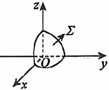

# 《张宇1000题》 · 强化篇 · 第18章 多元函数积分学

> 本章节收录第 760 页至第 788 页共 29 道题。

---

### 【ZY1000-QH-GS18-T01】第 1 题（P760）

1. 设 $\Omega=\{(x,y,z)\mid x^2+y^2+z^2\le1,x\ge0,y\ge0,z\ge0\}$，则 $\displaystyle\iiint_\Omega(x^2+2y^2+3z^2)\,dx\,dy\,dz=$_____.

> **【唯一编号】** `ZY1000-QH-GS18-T01`
> **【科目】** 强化篇
> **【专题】** 第18章 多元函数积分学

---

### 【ZY1000-QH-GS18-T02】第 2 题（P761）

2. 设曲线 $L$ 的方程为 $2x=y^2\ (0\le y\le1)$，则 $\displaystyle\int_Ly\,ds=$_____.

> **【唯一编号】** `ZY1000-QH-GS18-T02`
> **【科目】** 强化篇
> **【专题】** 第18章 多元函数积分学

---

### 【ZY1000-QH-GS18-T03】第 3 题（P762）

3. 设 $L$ 为曲线 $(x-\frac12)^2+(y-\frac12)^2=\frac12$，取逆时针方向，$\displaystyle I=\oint_L4y\,dx+(x+y)^2\,dy$，$\displaystyle J=\oint_L4x\,dx+(x+y)^2\,dy$，$\displaystyle K=\oint_L4xy\,dx+(x+y)^2\,dy$，则 $I,J,K$ 的大小顺序为（ ）。

- **A.** $I<K<J$
- **B.** $J<K<I$
- **C.** $I<J<K$
- **D.** $K<I<J$

> **【唯一编号】** `ZY1000-QH-GS18-T03`
> **【科目】** 强化篇
> **【专题】** 第18章 多元函数积分学

---

### 【ZY1000-QH-GS18-T04】第 4 题（P763）

4. 已知有界闭区域 $\Omega$ 由锥面 $z=\sqrt{x^2+y^2}$ 与平面 $z=1$ 围成，计算三重积分 $\displaystyle I=\iiint_\Omega(x+y+z)^2\,dx\,dy\,dz$.

> **【唯一编号】** `ZY1000-QH-GS18-T04`
> **【科目】** 强化篇
> **【专题】** 第18章 多元函数积分学

---

### 【ZY1000-QH-GS18-T05】第 5 题（P764）

5. 设 $\Gamma$ 是空间圆周 $\begin{cases}x^2+y^2+z^2=a^2,\\x+y+z=\frac32a\end{cases}\ (a>0)$，则 $\displaystyle\oint_\Gamma(2yz+2zx+2xy)\,ds=$_____.

> **【唯一编号】** `ZY1000-QH-GS18-T05`
> **【科目】** 强化篇
> **【专题】** 第18章 多元函数积分学

---

### 【ZY1000-QH-GS18-T06】第 6 题（P765）

6. 设 $\Gamma$ 是球面 $x^2+y^2+z^2=1$ 与平面 $x=y$ 的交线，则 $\displaystyle\oint_\Gamma(x^2+y^2)\,ds=$_____.

> **【唯一编号】** `ZY1000-QH-GS18-T06`
> **【科目】** 强化篇
> **【专题】** 第18章 多元函数积分学

---

### 【ZY1000-QH-GS18-T07】第 7 题（P766）

7. 设 $\Gamma$ 为球面 $x^2+y^2+z^2=m^2$ 与平面 $x+z=m\ (m>0)$ 的交线，计算 $\displaystyle I=\oint_\Gamma xz(1+yz-xy)\,ds$.

> **【唯一编号】** `ZY1000-QH-GS18-T07`
> **【科目】** 强化篇
> **【专题】** 第18章 多元函数积分学

---

### 【ZY1000-QH-GS18-T08】第 8 题（P767）

8. 设 $D=\{(x,y)\mid x^2+y^2\le4\}$，$\partial D$ 为 $D$ 的正向边界，则 $\displaystyle\oint_{\partial D}\frac{(xe^{x^2+4y^2}+y)\,dx+(4ye^{x^2+4y^2}-x)\,dy}{x^2+4y^2}=$_____.

> **【唯一编号】** `ZY1000-QH-GS18-T08`
> **【科目】** 强化篇
> **【专题】** 第18章 多元函数积分学

---

### 【ZY1000-QH-GS18-T09】第 9 题（P768）

9. 设函数 $f(x),g(x)$ 二阶导数连续，$f(0)=0$，$g(0)=0$，且对于平面上任一简单闭曲线 $L$，均有 $\displaystyle\oint_L[y^2f(x)+2ye^x+2yg(x)]\,dx+2[yg(x)+f(x)]\,dy=0$。

(1) 求 $f(x),g(x)$ 的表达式；

(2) 设 $L_1$ 为任一条从点 $(0,0)$ 到点 $(1,1)$ 的曲线，计算 $\displaystyle\int_{L_1}[y^2f(x)+2ye^x+2yg(x)]\,dx+2[yg(x)+f(x)]\,dy$.

> **【唯一编号】** `ZY1000-QH-GS18-T09`
> **【科目】** 强化篇
> **【专题】** 第18章 多元函数积分学

---

### 【ZY1000-QH-GS18-T10】第 10 题（P769）

10. 设 $P(x,y,z)$ 为球面 $\Sigma:x^2+y^2+z^2-2z=0$ 上的动点，球面 $\Sigma$ 在点 $P(x,y,z)$ 处的法线与平面 $x+z=0$ 平行。

(1) 求点 $P$ 的轨迹 $\Gamma$ 的方程；

(2) 计算曲线积分 $\displaystyle\oint_\Gamma y^2\,dx+z^2\,dy+x^2\,dz$，从 $z$ 轴正向看下去，$\Gamma$ 取逆时针方向。

> **【唯一编号】** `ZY1000-QH-GS18-T10`
> **【科目】** 强化篇
> **【专题】** 第18章 多元函数积分学

---

### 【ZY1000-QH-GS18-T11】第 11 题（P770）

11. 已知 $\Sigma$ 为曲面 $4x^2+y^2+z^2=1\ (x\ge0,y\ge0,z\ge0)$ 的上侧（见图），$L$ 为 $\Sigma$ 的边界曲线，其方向与 $\Sigma$ 的正法向量满足右手法则，计算曲线积分 $\displaystyle I=\oint_L(yz^2-\cos z)\,dx+2xz^2\,dy+(2xyz+x\sin z)\,dz$.

> **【唯一编号】** `ZY1000-QH-GS18-T11`
> **【科目】** 强化篇
> **【专题】** 第18章 多元函数积分学

---

### 【ZY1000-QH-GS18-T12】第 12 题（P771）

12. 设曲面 $z=\sqrt{1-x^2-y^2}$ 与平面 $z=-x$ 的交线为 $L$，起点为 $A(0,1,0)$，终点为 $B(0,-1,0)$，则 $\displaystyle\int_L(x+y-z)\,dx+|y|\,dz=$_____.

> **【唯一编号】** `ZY1000-QH-GS18-T12`
> **【科目】** 强化篇
> **【专题】** 第18章 多元函数积分学

---

### 【ZY1000-QH-GS18-T13】第 13 题（P772）

13. 设 $L$ 为曲线 $y=2\sqrt{1-x^2}$ 上从点 $(0,2)$ 到点 $(1,0)$ 的一段弧，则曲线积分 $\displaystyle\int_L(2y+1)\,dx+(3x+2)\,dy=$_____.

> **【唯一编号】** `ZY1000-QH-GS18-T13`
> **【科目】** 强化篇
> **【专题】** 第18章 多元函数积分学

---

### 【ZY1000-QH-GS18-T14】第 14 题（P773）

14. 设函数 $f(x,y)$ 在区域 $D=\{(x,y)\mid x^2+4y^2\le4\}$ 上二阶偏导数连续，$\partial D$ 是 $D$ 取正向的边界曲线，则 $\displaystyle\oint_{\partial D}[f'_x(x,y)-y]\,dx+f'_y(x,y)\,dy=$_____.

> **【唯一编号】** `ZY1000-QH-GS18-T14`
> **【科目】** 强化篇
> **【专题】** 第18章 多元函数积分学

---

### 【ZY1000-QH-GS18-T15】第 15 题（P774）

15. 设 $y'=f(x,y)$ 是一条简单封闭曲线 $L$（取正向），$f(x,y)\neq0$，其所围区域记为 $D$，$D$ 的面积为 $a$，$a>0$，则 $\displaystyle I=\oint_L xf(x,y)\,dx-\frac y{f(x,y)}\,dy=$_____.

> **【唯一编号】** `ZY1000-QH-GS18-T15`
> **【科目】** 强化篇
> **【专题】** 第18章 多元函数积分学

---

### 【ZY1000-QH-GS18-T16】第 16 题（P775）

16. 设 $\Gamma$ 为曲线 $\begin{cases}x^2+y^2+z^2=a^2,\\y=x\tan\theta,\end{cases}$，其中 $a>0$，$-\frac\pi2<\theta<\frac\pi2$ 且 $\theta\neq0$，从 $x$ 轴的正向看去，$\Gamma$ 的方向为顺时针方向。当 $\theta$ 为何值时，$\displaystyle I=\oint_\Gamma(y-z)\,dx+(z-x)\,dy+(x-y)\,dz$ 最大？并求出最大值。

> **【唯一编号】** `ZY1000-QH-GS18-T16`
> **【科目】** 强化篇
> **【专题】** 第18章 多元函数积分学

---

### 【ZY1000-QH-GS18-T17】第 17 题（P776）

17. 设函数 $f(x)$ 具有一阶连续导数，且对右半平面 $x>0$ 内任意分段光滑简单闭曲线 $L$，均有 $\displaystyle\oint_L\frac{f(x)y^2\,dy-y^3\,dx}{2x^2+y^6}=0$。

(1) 求 $f(x)$ 的表达式；

(2) 计算 $\displaystyle\oint_{L_0}\frac{f(x)y^2\,dy-y^3\,dx}{2x^2+y^6}$，其中 $L_0$ 为 $2x^2+y^2=1$，取逆时针方向。

> **【唯一编号】** `ZY1000-QH-GS18-T17`
> **【科目】** 强化篇
> **【专题】** 第18章 多元函数积分学

---

### 【ZY1000-QH-GS18-T18】第 18 题（P777）

18. 设 $L$ 为从点 $A(-1,0)$ 到点 $B(3,0)$ 的上半个圆周 $(x-1)^2+y^2=2^2$，$y\ge0$，则 $\displaystyle\int_L\frac{(x-y)\,dx+(x+y)\,dy}{x^2+y^2}=$_____.

> **【唯一编号】** `ZY1000-QH-GS18-T18`
> **【科目】** 强化篇
> **【专题】** 第18章 多元函数积分学

---

### 【ZY1000-QH-GS18-T19】第 19 题（P778）

19. 设 $f(x)$ 有连续导数，且 $f(0)=0$，若对于平面内的任意简单封闭曲线 $L$，均有曲线积分 $\displaystyle\oint_L[f(x)-e^x]y^2\,dx-2yf(x)\,dy=0$，则 $f(x)=$_____.

> **【唯一编号】** `ZY1000-QH-GS18-T19`
> **【科目】** 强化篇
> **【专题】** 第18章 多元函数积分学

---

### 【ZY1000-QH-GS18-T20】第 20 题（P779）

20. 设 $\displaystyle I_1=\int_L f(x,y)\,dx+(6xy-6x)\,dy$，$\displaystyle I_2=\int_L(6x^2y+6xy+x)\,dx+f(x,y)\,dy$。已知曲线积分 $I_1$ 与 $I_2$ 均在整个 $xOy$ 平面内与路径无关，且 $f(0,0)=0$，求函数 $f(x,y)$ 的极值。

> **【唯一编号】** `ZY1000-QH-GS18-T20`
> **【科目】** 强化篇
> **【专题】** 第18章 多元函数积分学

---

### 【ZY1000-QH-GS18-T21】第 21 题（P780）

21. 设 $\Sigma$ 为球面 $x^2+y^2+z^2=m$ 被平面 $z=\dfrac{\sqrt m}3$ 所截下的顶部，计算 $\displaystyle\iint_\Sigma\left(|x|y+\frac1z\right)dS$.

> **【唯一编号】** `ZY1000-QH-GS18-T21`
> **【科目】** 强化篇
> **【专题】** 第18章 多元函数积分学

---

### 【ZY1000-QH-GS18-T22】第 22 题（P781）

22. 设 $\Sigma$ 是由直线 $\begin{cases}x=0,\\y=0\end{cases}$ 绕直线 $\begin{cases}x=t,\\y=t,\\z=t\end{cases}$（$t$ 为参数）旋转一周得到的曲面，$\Sigma_1$ 是 $\Sigma$ 介于平面 $x+y+z=0$ 与 $x+y+z=1$ 之间部分的外侧。计算曲面积分 $\displaystyle I=\iint_{\Sigma_1}x\,dy\,dz+(y+1)\,dz\,dx+(z+2)\,dx\,dy$.

> **【唯一编号】** `ZY1000-QH-GS18-T22`
> **【科目】** 强化篇
> **【专题】** 第18章 多元函数积分学

---

### 【ZY1000-QH-GS18-T23】第 23 题（P782）

23. 设锥面 $\Sigma$ 的顶点是 $A(0,1,1)$，准线是 $\begin{cases}x^2+y^2=1,\\z=0,\end{cases}$，直线 $L$ 过顶点 $A$ 和准线上任一点 $M_1(x_1,y_1,0)$。$\Omega$ 是 $\Sigma\ (0\le z\le1)$ 与平面 $z=0$ 所围成的锥体。求：

(1) $L$ 和 $\Sigma$ 的方程；

(2) $\Omega$ 的形心坐标。

> **【唯一编号】** `ZY1000-QH-GS18-T23`
> **【科目】** 强化篇
> **【专题】** 第18章 多元函数积分学

---

### 【ZY1000-QH-GS18-T24】第 24 题（P783）

24. 设锥面 $\Sigma$ 的顶点为原点，准线为曲线 $\Gamma:\begin{cases}z=y^2,\\x=1\end{cases}\ (|y|\le1)$。

(1) 求 $\Sigma$ 的方程；

(2) 计算 $\displaystyle I=\iint_\Sigma2x^2\,dy\,dz+xy\,dz\,dx+(z+1)\,dx\,dy$，$\Sigma$ 取上侧。

> **【唯一编号】** `ZY1000-QH-GS18-T24`
> **【科目】** 强化篇
> **【专题】** 第18章 多元函数积分学

---

### 【ZY1000-QH-GS18-T25】第 25 题（P784）

25. 设 $a,b$ 为实数，函数 $f(x,y)=ax^2+by^2$ 在点 $(1,1)$ 处沿方向 $\mathbf{l}=\mathbf{i}+\mathbf{j}$ 的方向导数最大，最大值为 $2\sqrt2$。若 $\Sigma$ 为曲面 $x^2+z^2=2z$ 被曲面 $z=\sqrt{f(x,y)}$ 所截取的部分。

(1) 求 $a,b$ 的值；

(2) 计算 $\displaystyle\iint_\Sigma z\,dS$.

> **【唯一编号】** `ZY1000-QH-GS18-T25`
> **【科目】** 强化篇
> **【专题】** 第18章 多元函数积分学

---

### 【ZY1000-QH-GS18-T26】第 26 题（P785）

26. 设 $\Sigma$ 是柱面 $x^2+y^2=1$ 介于平面 $z=0$、$z=2$ 之间的部分，方向向外。记 $\displaystyle I_1=\iint_\Sigma x^2\,dS$，$\displaystyle I_2=\iint_\Sigma z^2\,dS$，$\displaystyle I_3=\iint_\Sigma(x^2+z^2)\,dy\,dz$，则（ ）。

- **A.** $I_1>I_2>I_3$
- **B.** $I_2>I_1>I_3$
- **C.** $I_3>I_1>I_2$
- **D.** $I_3>I_2>I_1$

> **【唯一编号】** `ZY1000-QH-GS18-T26`
> **【科目】** 强化篇
> **【专题】** 第18章 多元函数积分学

---

### 【ZY1000-QH-GS18-T27】第 27 题（P786）

27. 设 $P=2xzf(y+z)-y^3$，$Q=2yzf(y+z)+x^3$，$\displaystyle R=\int_0^{x^2+y^2}f(z-t)\,dt$，其中 $f$ 具有一阶连续导数。$L$ 为曲面 $z=x^2+y^2$ 与平面 $y+z=1$ 的交线，从 $z$ 轴正向往下看为逆时针方向，计算 $\displaystyle\oint_LP\,dx+Q\,dy+R\,dz$.

> **【唯一编号】** `ZY1000-QH-GS18-T27`
> **【科目】** 强化篇
> **【专题】** 第18章 多元函数积分学

---

### 【ZY1000-QH-GS18-T28】第 28 题（P787）

28. 设 $\Sigma$ 为曲面 $z=\sqrt{1-x^2-y^2}$，$\alpha,\beta$ 分别为曲面 $\Sigma$ 的外法线向量与 $x$ 轴、$z$ 轴的夹角，则 $\displaystyle\iint_\Sigma(|xy|\cos\alpha+z^2\cos\beta)\,dS=$_____.

> **【唯一编号】** `ZY1000-QH-GS18-T28`
> **【科目】** 强化篇
> **【专题】** 第18章 多元函数积分学

---

### 【ZY1000-QH-GS18-T29】第 29 题（P788）

29. 设曲面 $\Sigma:z=1-x^2-y^2\ (z\ge-3)$，取上侧，求曲面积分 $\displaystyle I=\iint_\Sigma yz\sqrt{x^2+y^2+z^2}\,dy\,dz+xz\sqrt{x^2+y^2+z^2}\,dz\,dx+(x^2y^2-2xy\sqrt{x^2+y^2+z^2})\,dx\,dy$.

> **【唯一编号】** `ZY1000-QH-GS18-T29`
> **【科目】** 强化篇
> **【专题】** 第18章 多元函数积分学

---

